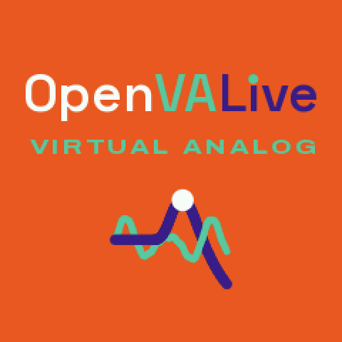
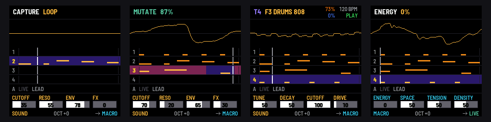

# OpenVALive FM-1

<p align="center"></p>

**An open-source, live-first instrument for the M-VAVE FM-1.** A virtual analog synth and a drum machine on four
looping tracks, played like an instrument: no menus on stage.



Play freely and press **CAPTURE**: what you played loops, in time. Undo anything. Glide between scenes with one knob.
Hold a key to stutter or sweep. Let the **Creative Engine** mutate, humanize, fill or simplify your loops.

> 🇫🇷 **Français** — toute la documentation existe en français dans [`docs/_FR`](docs/_FR/), à commencer par
> [l'installation](docs/_FR/04-installation.md) et [l'utilisation](docs/_FR/05-utilisation-fm1.md).

## The OpenVALive family

| Repository | What | Licence |
|---|---|---|
| **OpenVALive_FM-1** (this one) | the FM-1 firmware, its site, web installer and emulator | MIT |
| [OpenVALive_CORE](https://github.com/Tom-Rfid/OpenVALive_CORE) | the synth itself: DSP, VA and drum engines, Live Core, the app, the desktop app — here in `va/` | MIT |
| [OpenVALive_SMK-37](https://github.com/Tom-Rfid/OpenVALive_SMK-37) | the same instrument on the SMK-37 Elite / Pro | GPL-3.0 |

On [The Firmware Hub](https://thefirmwarehub.com): **FM-1_023** (this firmware) and **FM-1_037** (the SMK-37's).

## Highlights

| | |
|---|---|
| 🎛️ **Four tracks, one clock** | synths or drums on each track, own loop lengths, swing, MIDI clock in and out |
| 🔊 **29 sounds in 7 families** | F1 acid (303, square, scream, deep), F2 basses (Reese, wobble, deep sub…), F3 five drum kits (808, 909…), F4 leads and keys, F5 pads, F6 textures (dub siren…), F7 your own; PRESET then OCT−/OCT+ jumps family |
| 🥁 **Drum keys** | the ORIGINAL map (toms high → low, choosable D# and G#) or GM, with key lights |
| 🎯 **CAPTURE and LOOP EDIT** | the last phrase you played becomes the loop, in time; then edit it note by note (HOME + key 9) |
| ↩️ **Undo everything** | 8 steps: takes, captures, creative gestures, clears, edits |
| 🧬 **Creative Engine** | Mutate, Humanize, Fill, Simplify, Rotate, Reverse, Euclid… one gesture each, its % shown before you take it |
| 🌗 **Scenes and Morph** | 8 snapshots; one knob glides between two of them |
| 🔥 **Hold-to-play effects** | stutter, filter, delay throw, drive — push and release: the arrow ↑ shows what letting go takes |
| 🎚️ **MAP CONTROL and SOUND EDIT** | choose the knob pages and what every knob controls; a master EQ page; every parameter, the modulation matrix and tempo-locked LFOs |
| 🔌 **MIDI & audio** | MIDI in over USB and TRS, MIDI out over USB, controller mode, USB audio |
| 🌐 **Try it without an FM-1** | the whole firmware runs in your browser |

## Get started

| I want to... | Do this |
|---|---|
| **try it now** | the [browser emulator](https://tom-rfid.github.io/OpenVALive_FM-1/emu/) |
| **install it on my FM-1** | the [web installer](https://tom-rfid.github.io/OpenVALive_FM-1/install/) (Chrome / Edge), or the latest [release](https://github.com/Tom-Rfid/OpenVALive_FM-1/releases): `OpenVALive-FM1-X.Y.Z.zip`, then `FLASH-FM1.bat` ([guide](docs/_EN/04-install.md)) |
| **bring back a unit that no longer starts** | [jieli-usbkey-unbrick](https://github.com/Tom-Rfid/jieli-usbkey-unbrick) (also in `recovery/`): a Raspberry Pi through the USB cable, the unit stays closed |
| **build everything on Windows** | double-click `INSTALL-WINDOWS.bat` (WSL, toolchain, tests, firmware, flash) |
| **build on Linux** | `git clone --recursive`, then [15 — from zero to a flashed FM-1](docs/_EN/15-from-zero-to-fm1.md) |
| **play it on my PC** | the desktop app of [OpenVALive_CORE](https://github.com/Tom-Rfid/OpenVALive_CORE) |

## Repository map

```
targets/fm1/   the FM-1 target: app.h (name, flash map), app.c and ols_dsp.c (one line each: the app in va/),
               fm1.toml, site, manual, simulator scripts
va/            OpenVALive CORE, a git submodule pinned to one version (sh scripts/va.sh status)
recovery/      jieli-usbkey-unbrick (submodule): bring back a unit that no longer starts
scripts/       va.sh / va.ps1 (the submodule), Windows / WSL install, flash, update-prebuilt
tests/         run_tests.sh: OpenVALive CORE's tests, no-libc build, the app in the fm1-base simulator
docs/          _EN (English) and _FR (français)
```

## Documentation

| | English | Français |
|---|---|---|
| Overview | [01](docs/_EN/01-overview.md) | [01](docs/_FR/01-presentation.md) |
| The synth inside: how it is wired | [03](docs/_EN/03-the-synth-inside.md) | [03](docs/_FR/03-le-synthe-a-l-interieur.md) |
| Install | [04](docs/_EN/04-install.md) | [04](docs/_FR/04-installation.md) |
| Using the FM-1 | [05](docs/_EN/05-using-the-fm1.md) | [05](docs/_FR/05-utilisation-fm1.md) |
| Troubleshooting | [10](docs/_EN/10-troubleshooting.md) | [10](docs/_FR/10-depannage.md) |
| How the firmware is built (JieLi) | [11](docs/_EN/11-how-the-firmware-is-built.md) | [11](docs/_FR/11-compilation-du-firmware.md) |
| Web simulator and site | [14](docs/_EN/14-web-simulator-and-site.md) | [14](docs/_FR/14-simulateur-web-et-site.md) |
| From zero to a flashed FM-1 | [15](docs/_EN/15-from-zero-to-fm1.md) | [15](docs/_FR/15-de-zero-au-fm1.md) |
| Publishing (releases, The Firmware Hub) | [17](docs/_EN/17-publishing.md) | [17](docs/_FR/17-publication.md) |
| Rules: code, git, publishing | [18](docs/_EN/18-rules-git-and-publishing.md) | [18](docs/_FR/18-regles-git-et-publication.md) |
| FM-1 test plan | [19](docs/_EN/19-fm1-test-plan.md) | [19](docs/_FR/19-plan-de-test-fm1.md) |
| The sounds and the drum keys | [20](docs/_EN/20-sounds-and-drum-keys.md) | [20](docs/_FR/20-sons-et-touches-batterie.md) |

The synth, the Live Core, writing an engine, the API: [OpenVALive_CORE's docs](https://github.com/Tom-Rfid/OpenVALive_CORE#readme).
To pick the project up: [STATUS.md](STATUS.md) · [CLAUDE.md](CLAUDE.md) · [CONTRIBUTING.md](CONTRIBUTING.md) ·
[CHANGELOG.md](CHANGELOG.md).

## Built with

[fm1-base](https://github.com/charlesvestal/fm1-base) (Charles Vestal, MPL-2.0) and
[felucca-bsp](https://github.com/hugelton/felucca-bsp) (Leo Kuroshita / Hügelton Instruments, MPL-2.0). Thank you —
none of this would run without their work. OpenVALive is not affiliated with or endorsed by M-VAVE or JieLi.

Licence: MIT ([LICENSE](LICENSE)).
