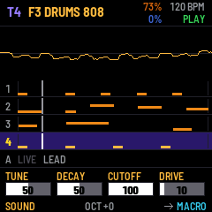

# 05 — Using the FM-1 (V0.2)

The illustrated manual published with the firmware is [`targets/fm1/docs/MANUAL.md`](../../targets/fm1/docs/MANUAL.md).
This page is the quick reference. How the loops, CAPTURE and the Creative Engine work inside:
[16 — The Live Core](https://github.com/Tom-Rfid/OpenVALive_CORE/blob/dev/docs/_EN/16-the-live-core.md).

 

## Controls

| Control | Action |
|---|---|
| **Keys** | play the selected track, with velocity; also out over USB-MIDI (channel 1) |
| **SELECT** (turn) | track 1 to 4 |
| **PRESET** (turn) | sound of the track: in this order: ACID 303, BASS, SUB, the 5 drum kits (808, 909, TIGHT, LOFI, IRON), LEAD, PLUCK, BRASS, ORGAN, PAD, STRINGS, SWEEP, GRUNGE, SCREECH, DRONE, WIND, HOLD, WHALE, INIT, then USER 1–8 |
| **ALGO** (turn) | tempo, 20 to 300 BPM |
| **K1..K4** | the knob page (below) |
| **FX** | next knob page (SOUND orange / MACRO cyan / LIVE mint / SETUP pink / USER violet) |
| **SEL** | held: the tracks layer (below); pressed: takes a sound waiting (**+SEL**); held + SELECT: point at a line, let go: select it — from A (SEL lit): **swap** A and that track (sounds, effects, octaves; ENV on the track swaps back) |
| **SELECT past track 4** | **A**, the live line: the keys play A's own sound live (PRESET), not recorded; ARP tapped = arpeggio UP / DOWN / UP-DOWN / RANDOM; gestures act on every track |
| **PLAY** | play / stop |
| **REC** | record into the track while playing (on release); a take is one undo step. **REC + the leftmost white key, REC let go first: RESET** the selected track's loop (ENV undoes it) |
| **EDIT** | tapped: **CAPTURE** (the phrase just played becomes the loop; on a track without a loop yet, from its first note the line paints green as the playhead goes, the red infinity sign shows and EDIT blinks fast: tap when the loop has come round); held + keys while playing: **PUNCH** (records over, replacing, until EDIT is let go; EDIT flickers while recording) |
| **ENV / LFO** | UNDO / REDO (8 steps) of the selected track; none on A (live only) |
| **SAVE** + **1st black key** (F#3), SAVE let go first | **SAVE ALL**: the whole live set (sounds, loops, scenes, tempo...), in steps over about a second, only what changed; the key blinks when something is to be saved, SAVE blinks while it saves. SAVE alone saves nothing. SAVE is lit when something changed (a mute does not count) |
| **SAVE + white key 1–8** / **9–16**, SAVE let go first | **LOAD** USER 1–8 on the selected line (on a screen keyboard: violet = a sound to load, grey = empty) / **SAVE** the line's sound as USER 1–8 (pink; mint / pink in turn = one there already, replaced) |
| **SEL + REC / SEL + PLAY** | metronome / tap tempo. REC and CAPTURE (EDIT) only while playing: at STOP, “PLAY FIRST” |
| **HOME held at power-on** | safe start: the saved set is not loaded |
| **HOME** + white key 1 / 2 / 3, HOME let go first | PANIC / RESTART (every track from its start) / STOP ALL |
| **FX** + white key 1, FX let go first | the line's reset: effects off, unmuted, octave 0, level unity |
| **FX** + white key 15 / 16, FX let go first | drum keys ORIGINAL / GM ([20](20-sounds-and-drum-keys.md)), kept at once |
| **HOME** + white key 7 (E4), HOME let go first | **OPTION CONTROL**: DRUM KEYS (ORIGINAL / GM), **PERC 1–4** (each D# / G# key of the drum keyboard its own percussion: G#3, D#4, G#4, D#5; COWBELL, CLAP, TRIANGLE, RIM, PEDAL HAT, BELL HIGH, BELL LOW, TRI MUTE, TAMBOURINE, CLAVES), KEYS ON SCREEN, **T1–T4 / A NEW SOUND** (the page a new sound on that line brings: KEEP or a page). EDIT: the row's default |
| **GLO + SEL** | **MAP CONTROL**: the knob pages in FX's order (PRESET moves one, ALGO shows / hides it), then what K1–K4 do on MACRO, LIVE, EQ and USER (PRESET the target, ALGO the option; a changed one in cyan). Among the targets **PAN**: a knob puts a track left / right in the stereo field (notched in the middle), the FM-1's stereo control. EDIT: the row's default. The last row of SOUNDS, MAP CONTROL and OPTION CONTROL (MENU) goes from one to the next with PRESET or OCT; any menu button closes and keeps |
| **PRESET**, then OCT− / OCT+ within 2 s (or while a sound waits for SEL) | jump to the previous / next **family** of sounds, shown before the name: F1 acid, F2 psy (psy bass, zaps, blips, arp), F3 basses, F4 drums, F5 punch, F6 SFX (risers, noise, weather), F7 under (underground), F8 soft, F9 USER |
| **FX** (tap) on a drum track | the pages go round SOUND → MACRO → LIVE → SETUP → USER → **EQ** → **DRUM EQ** (red; the order and the pages shown: MAP CONTROL): K1 BASS, K2 TREBLE, K3 the kick's level, K4 the hats' (a synth track skips it) |
| **HOME** + white key 8 (F4), HOME let go first | **SOUNDS**: which sounds PRESET offers. The screen stays open with HOME let go (both hands free). One line a family F1–F9: the whole line red = family hidden, “F2” blue = partly, green = all offered; a square a sound; on the chosen line, the chosen sound's name (and under the title its place “3/5”, its family and ON / HIDDEN). Each family's name takes its colour. SELECT the line, PRESET the sound, SEL offered (green) / hidden (red), OCT− / OCT+ the whole family hidden / offered. Last line **→ NEXT PAGE** (the help says "<- PRESET ->"): PRESET or OCT goes on to **MAP CONTROL** (OCT−: **OPTION CONTROL**), which have the same last line; a list longer than the screen has a scroll bar on the right. Any menu button (HOME, FX, ARP, SEQ, GLO, SAVE) closes and saves. A hidden sound still plays where it is; PRESET and the family jumps skip it |
| **HOME** + the 4th black key (C#4), HOME let go first | **LOOP EDIT** of the selected track: SELECT goes from note to note (it sounds), a key gives it its pitch, K1 position (1/16), K2 length, K3 velocity, K4 pitch; REC takes the note out, EDIT adds one a 1/16 later, **EDIT held + keys** add notes at the same place (a chord); PLAY plays on; HOME or SEL back. The whole edit is one UNDO (ENV) |
| **OCT− / OCT+** | octave of the selected line, −3 to +3 (T1..T4 and A each their own; a USER sound brings back its octave); a LOOP running: ×2 / ÷2 |
| **MASTER** | volume |

### Knob pages

| Page | K1 | K2 | K3 | K4 |
|---|---|---|---|---|
| SOUND, synth | CUTOFF | RESO | ENV | FX (delay) |
| SOUND, drums | TUNE | DECAY | CUTOFF | DRIVE |
| SOUND, controller mode | CC 74 | CC 71 | CC 75 | CC 94 |
| MACRO (all tracks) | ENERGY | SPACE | TENSION | DENSITY |
| LIVE | MORPH (between the last two scenes recalled) | SWING | PUMP (sidechain) | LEVEL (0–100, 67 = unity) |
| SETUP (preparation) | MIDI IN | XFADE (cut, 1, 2, 4 bars) | QUANTIZE | BARS (1–8; bars added repeat the loop) |
| USER | what you gave them (MAP CONTROL) | | | |
| EQ (the master, orange) | BASS (±12 dB, 120 Hz) | MID (±12 dB) | TREBLE (±12 dB, 8 kHz) | MID FREQ (250 Hz – 4 kHz) |

MACRO, LIVE and EQ's knobs can be given other targets in MAP CONTROL, like USER's.

### Hold a layer button + a white key (F3 = key 1 ... G5 = key 16)

| Layer | Keys |
|---|---|
| **ARP** creative | 1 MUTATE · 2 HUMANIZE · 3 FILL · 4 SIMPLIFY · 5/6 ROTATE </> · 7 REVERSE · 8/9 TRANSPOSE −/+ · 10 EXPAND · 11 CONTRACT · 12 CHANCE · 13 RATCHET · 14/15 OCTAVE −/+ — strength = velocity; on a track, let ARP go before the key to apply (mint), the key first to give up |
| **GLO** scenes (GLO let go before the key = taken, the key first = given up) | 1–8 **LOAD** scene 1–8 (playing: on the next bar, cut or cross-fade) · 9–16 **SAVE** scene 1–8 (pink on a screen keyboard) · GLO + PLAY scene chain · ARP + SEL **SOUND EDIT** (every parameter of the track's sound: waves, filter, envelopes, tempo-locked LFOs, modulation matrix) · GLO + SEL **MAP CONTROL** (what the USER page's 4 knobs do: an effect, a level, a macro, a MIDI CC…) · GLO + ALGO bars per scene |
| **SEQ** perform (on a track: SEQ let go before the key = on, latched, again = off; SEQ tapped = the loop lets go; OCT−/OCT+ = loop ×2 / ÷2. On A: hold = while held, tap = latched) | 1–6 LOOP 1 bar…1/32 · 7 FILTER SHUT · 8 FILTER OPEN · 9 DELAY THROW · 10 DRIVE · 11 CRUSH · 12 BREAK · 13 SOLO · 14 DRUMS ONLY · 15 ALL OUT · 16 ALL FX OFF — tracks taken out come back on the next bar; a LOOP running: its track turns red, SEQ flickers; an effect taken: white on green at the bottom, 0.5 s |
| **SEL** tracks | 1–4 mute, at once (lit: playing; fast blink: muted) · 5 (free) · 6 to 16 **valid on release** (SEL let go first, the key still held), like ARP / SEQ / GLO: 6 CLEAR (A: every track) · 7 QUANTIZE · 8 CLOCK IN · 9 CLOCK OUT · 10–15 EUCLID 3..8 hits / 16 · 16 **PLAY MODE** LIVE ↔ FULL MIDI (also in OPTION CONTROL). Black keys: **1st (F#3) MUTE ALL 4** (A plays on; fast blink while all are out) · **4th (C#4) A VOL** (valid on release, SEL let go first): the playing tracks' levels and A's go to one level — the 2 middle ones averaged with 4 tracks, the 2 loudest with 2 or 3 — step by step over the longest loop (a 4-bar loop: 4 bars), then it stops (again: stopped; a LEVEL turned by hand stops it; the key swells slowly, 2 s, while it runs; “A VOL” at the right of the SEL title) |

## The screen

```
T4  DRUMS 808            120 BPM
                     6%     PLAY
───────────────────────────────── oscilloscope
1 ▬  ▬   ▬  ▬  │  ▬   ▬          the four loops, the playhead,
2 ▬▬    ▬▬   ▬▬│     ▬▬          the selected track in white,
3 ▬    ▬▬▬     │   ▬             a muted one dim
4              │
CUTOFF  RESO   ENV    SEQ
55      20     58     25
            OCT +0       SOUND
```

## The band

| Track | Sound | Voices |
|---|---|---|
| 1 | ACID 303: TB-303 style, glide, accents | 4 (ACID itself is mono) |
| 2 | BASS: mono legato + glide, saw + sub, drive | 1 |
| 3 | LEAD: mono, PWM square + saw, vibrato, delay | 2 |
| 4 | DRUMS 808: kick, snare, clap, hats, toms, rim, cowbell (every octave: C kick, D snare, F# hat, G# triangle, A# open hat...) | — |

Any track can take any sound (PRESET). 11 voices in all keep four busy tracks inside the CPU; above 90 % a voice
is dropped from the busiest track.

## MIDI

In (**USB** and the **TRS jack**, all channels): plays the selected track and is recorded and captured like the
keys; CC 74/71 cutoff/resonance, 73/72 attack/release, 5 glide, 1 vibrato, 93/94 chorus/delay, 120/123 all off;
pitch bend ±2. **MIDI clock** in (start, stop, continue, tempo) when CLOCK IN is on.

**Controller mode** (SEL + white key 16, "local off"): the keys and knobs only send MIDI (channel = track
number, knobs = CC 74 71 75 94); the loops keep playing inside. The FM-1 becomes a MIDI keyboard.

Out (**USB** only, the FM-1 has no MIDI OUT jack): keys on the selected track's channel, the loops of tracks 1–4 on channels 1–4,
MIDI clock and start/stop when CLOCK OUT is on. The device shows up as "OpenVALive FM-1".

### Sync with a drum machine (Roland T-8...) or a DAW

- **T-8 leads** (no computer): T-8 MIDI OUT → FM-1 MIDI IN (TRS). On the FM-1: SEL + white key 8 (CLOCK IN), and
  hold SEL + turn PRESET to **CLOCK only** (the T-8 also sends its notes: bass on channel 2, drums on 10). Press
  START on the T-8.
- **FM-1 leads**: its clock goes out over USB only (no MIDI OUT jack): through a computer or a USB MIDI host box to
  the T-8, whose "MIDI Clock Sync" is on AUTO, USB or MIDI. On the FM-1: SEL + white key 9 (CLOCK OUT).
- Cables: the T-8 uses **TRS MIDI Type A**. If a plain TRS cable gives nothing, use DIN adapters. The T-8's SYNC
  jacks (analog pulses) cannot be read by the FM-1.
- Incoming MIDI is time-stamped where it lands, so the tempo is followed without jitter.
- Program change n recalls scene n + 1; channel pressure (or pressing a key harder) opens the filter.

## USB audio

fm1-base includes USB audio: the FM-1 is also a **sound card** for the computer. Record it directly in your DAW.
With nothing in the headphone jack, the speaker gets a 130 Hz low cut (it cannot play deeper bass, only distort it).
