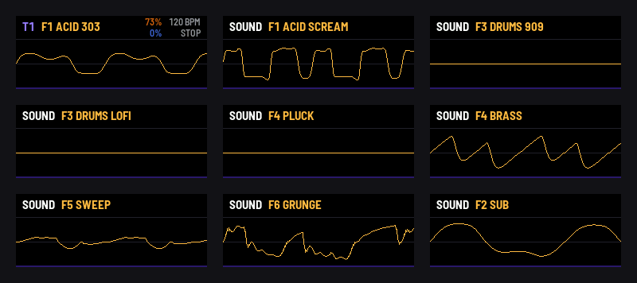
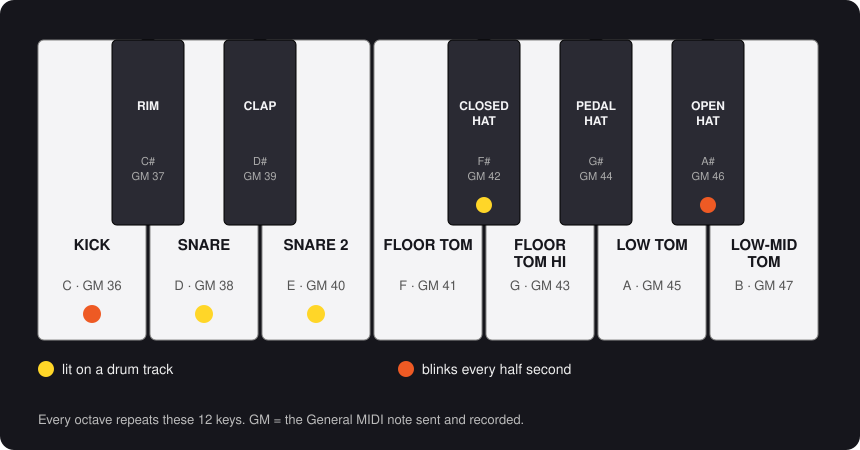

# 20. The sounds and the drum keys

PRESET turns through the 36 factory sounds in this order (nine families, F1–F9 with USER; OCT− / OCT+ jump between them, SOUNDS chooses which ones PRESET offers), then USER 1–8 (the sounds you keep with SAVE + white key).
Track 1 starts on **ACID 303** (tracks 2, 3, 4: BASS, LEAD, DRUMS 808). A runs the synth sounds and USER sounds that
hold a synth. The same list on the FM-1 and the SMK-37. Every button and key of the FM-1: [05](05-using-the-fm1.md).

The scope above shows one low note of each (the scope adjusts its gain so a quiet sound shows its shape too):
ACID's resonant saw, SUB's round wave, BRASS's saw, PAD's chorus, GRUNGE driven and crushed, SCREECH's whistling
filter, WHALE's pure tone, INIT's two saws, a kick.

| # | Sound | Family | What it is |
|---|---|---|---|
| 1 | **ACID 303** | F1 acid | TB-303 style: one saw, high resonance, short envelope, glide; hard notes open the filter (accents), overlapping notes slide. |
| 2 | **ACID SQUARE** | F1 acid | the 303's other wave: a square, hollower, the same squelch and glide. |
| 3 | **ACID SCREAM** | F1 acid | acid that screams: resonance at the edge, short hard filter envelope, pushed drive. For build-ups. |
| 4 | **ACID DEEP** | F1 acid | round, hypnotic acid: low filter, long decay, longer glide, a little echo (minimal, dub techno). |
| 5 | **BASS** | F2 basses | mono legato with glide: saw + sub-octave, snappy resonant filter, drive. |
| 6 | **SUB** | F2 basses | round triangle and its sub-octave, a touch of drive. |
| 7 | **REESE** | F2 basses | drum & bass Reese: two saws detuned against each other, low-passed, mono. |
| 8 | **WOBBLE** | F2 basses | an LFO on the tempo (1/8, from each note) opens and shuts the filter: dubstep / DnB wobble. |
| 9 | **DEEP SUB** | F2 basses | dub's deep sub: round, the sub oscillator full, almost no filter movement. |
| 10 | **DRUMS 808** | F3 drum kits | analog-style drum machine: boomy kick, soft snare, hats, clap, toms, rim, cowbell, triangle. |
| 11 | **DRUMS 909** | F3 drum kits | 909 style from the same voices: a higher, shorter kick with its click, a cracking snare, bright metallic hats (computed, not samples). |
| 12 | **DRUMS TIGHT** | F3 drum kits | short and punchy, for fast patterns. |
| 13 | **DRUMS LOFI** | F3 drum kits | dark and driven. |
| 14 | **DRUMS IRON** | F3 drum kits | industrial: low, metallic, distorted, long rattling hats. |
| 15 | **LEAD** | F4 leads | mono legato: pulse-width-modulated square + saw an octave up, vibrato, delay. |
| 16 | **PLUCK** | F4 leads | a bright attack that dies away, echoes behind it. |
| 17 | **STAB** | F4 leads | the house / techno chord stab: two saws, a short snappy filter and amp, chorus, an echo. Play chords, short. |
| 18 | **BRASS** | F4 leads | the filter opens after the attack, like a breath. |
| 19 | **SCREECH** | F4 leads | metal screech: a filter on the edge of whistling, swept and crushed. |
| 20 | **ORGAN** | F5 keys | triangle + square an octave up + sub, chorus II as a rotary. |
| 21 | **POLY** | F5 keys | warm poly chords, Juno style: two saws gently detuned, the filter half open, a soft attack, both choruses. |
| 22 | **VINTAGE KEYS** | F5 keys | a 70s electric piano: a bell-like start that fades, darker when soft, a slow tremolo and chorus I. |
| 23 | **PAD** | F6 pads | slow attack, moving filter, Juno-style chorus, delay. |
| 24 | **STRINGS** | F6 pads | string ensemble: detuned saws, slow attack, both choruses. |
| 25 | **STRINGS 70** | F6 pads | a 70s string machine: two saws close together, a gentle attack, both choruses deep (the ensemble) and a slow phaser. |
| 26 | **SWEEP** | F6 pads | the pad through the phaser. |
| 27 | **GRUNGE** | F7 textures | detuned saws and sub, driven hard, phaser and bitcrusher. |
| 28 | **DRONE** | F7 textures | an octave-down square under a saw, a filter breathing over half a minute. Hold a chord. |
| 29 | **HOLD** | F7 textures | a ship's hold: creaks, the hull groaning, long echoes. |
| 30 | **INIT** | F7 textures | two slightly detuned saws: a neutral start for SOUND EDIT. |
| 31 | **THUNDER** | F8 SFX | thunder: noise through a closed low-pass that swells in and rumbles; low notes boom (the sub), a hard hit cracks. Hold it for a long roll. |
| 32 | **RAIN** | F8 SFX | rain: bright noise in a band-pass, drops from a fast random level and filter; higher notes, lighter rain. Chorus spreads it wide. |
| 33 | **WIND** | F8 SFX | filtered noise: the keys move the band, a slow LFO breathes. |
| 34 | **CREAK** | F8 SFX | a door or a hull creaking: a low saw through a sharp band-pass, cut into grains, the pitch slowly bending; slow notes groan, hard ones crack. |
| 35 | **WHALE** | F8 SFX | a pure tone sliding for seconds between notes, slow sway, far echoes. Play legato, low. |
| 36 | **DUB SIREN** | F8 SFX | the dub siren: a square swept up and down by a slow LFO, into a long echo. Hold a note. |

On a synth sound the four SOUND knobs are CUTOFF, RESO, ENV, FX (delay); SOUND EDIT (ARP + SEL) opens every parameter.

## The drum keys

On a drum track each key plays one instrument, and every octave repeats the same 12 keys. Two maps, chosen with
**FX + white key 15** (ORIGINAL) or **FX + white key 16** (GM), FX let go first; kept at once, past a power cycle
(no SAVE). Also in OPTION CONTROL: **HOME + white key 16** (HOME let go first).

Whatever the map, a key sends the **General MIDI note** of its instrument (a kick is 36, a closed hat 42) to the loop,
to MIDI OUT and to a computer: Ableton's Drum Racks and FL Studio's FPC play the right drums with no set-up.

**ORIGINAL**, made to be played: the toms go from high to low left to right, like a kit seen from the stool; D# and
G# keys each play the sound you choose for that key in OPTION CONTROL (PERC 1–4 on the FM-1: G#3, D#4, G#4, D#5;
PERC 1–6 on the SMK-37: D#3 to G#5): COWBELL, CLAP, TRIANGLE, RIM, PEDAL HAT, BELL HIGH, BELL LOW (two agogo bells
above the cowbell), TRI MUTE (a triangle held by the hand), TAMBOURINE, CLAVES. By default every D# a COWBELL,
every G# a TRIANGLE; EDIT on a row puts its default back. Several bells and triangles can be on the keyboard at once.

**GM**, the computers' map: General MIDI's 36 to 47, every octave.

The lights: the kicks and the open hat blink every half second, the snares and the closed hat are lit (on the
SMK-37, whose keys have no lights, the screen shows them while a layer button is held).

From MIDI IN, the drums follow General MIDI's map whatever the map of the keys: 35 / 36 kick, 37 rim, 38 / 40 snare,
39 clap, 41 / 43 floor tom, 45 low tom, 47 / 48 mid tom, 50 high tom, 42 / 44 / 54 closed hat, 46 and the cymbals
(49, 51, 52, 53, 55, 57, 59) open hat, 56 cowbell, 75 rim (claves), 80 / 81 triangle; a note GM does not name plays
as its place in 36..47. The six GM toms play on four voices, each at its own pitch. The velocity sets the strength.
On a drum track the four SOUND knobs are TUNE, DECAY, CUTOFF and DRIVE for the whole kit. On the SMK-37 the pads in
PLAY mode play GM 36 to 51, as drum machines do. The scripts: `scripts/make-drum-keys.py` (these pictures).
