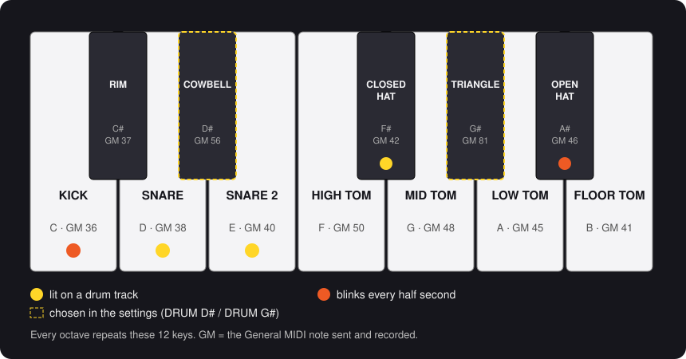

# 20. The sounds and the drum keys

PRESET turns through the 22 factory sounds in this order, then USER 1–8 (the sounds you keep with SAVE + white key).
Track 1 starts on **ACID 303** (tracks 2, 3, 4: BASS, LEAD, DRUMS 808). A runs the synth sounds and USER sounds that
hold a synth. The same list on the FM-1 and the SMK-37. Every button and key of the FM-1: [05](05-using-the-fm1.md).

The scope above shows one low note of each (the scope adjusts its gain so a quiet sound shows its shape too):
ACID's resonant saw, SUB's round wave, BRASS's saw, PAD's chorus, GRUNGE driven and crushed, SCREECH's whistling
filter, WHALE's pure tone, INIT's two saws, a kick.

| # | Sound | Family | What it is |
|---|---|---|---|
| 1 | **ACID 303** | basses | TB-303 style: one saw, high resonance, short envelope, glide; hard notes open the filter (accents), overlapping notes slide. |
| 2 | **ACID SQUARE** | basses | the 303's other wave: a square, hollower, the same squelch and glide. |
| 3 | **ACID SCREAM** | basses | acid that screams: resonance at the edge, short hard filter envelope, pushed drive. For build-ups. |
| 4 | **ACID DEEP** | basses | round, hypnotic acid: low filter, long decay, longer glide, a little echo (minimal, dub techno). |
| 5 | **BASS** | basses | mono legato with glide: saw + sub-octave, snappy resonant filter, drive. |
| 6 | **SUB** | basses | round triangle and its sub-octave, a touch of drive. |
| 7 | **REESE** | basses | drum & bass Reese: two saws detuned against each other, low-passed, mono. |
| 8 | **WOBBLE** | basses | an LFO on the tempo (1/8, from each note) opens and shuts the filter: dubstep / DnB wobble. |
| 9 | **DEEP SUB** | basses | dub's deep sub: round, the sub oscillator full, almost no filter movement. |
| 10 | **DRUMS 808** | drum kits | analog-style drum machine: boomy kick, soft snare, hats, clap, toms, rim, cowbell, triangle. |
| 11 | **DRUMS 909** | drum kits | 909 style from the same voices: a higher, shorter kick with its click, a cracking snare, bright metallic hats (computed, not samples). |
| 12 | **DRUMS TIGHT** | drum kits | short and punchy, for fast patterns. |
| 13 | **DRUMS LOFI** | drum kits | dark and driven. |
| 14 | **DRUMS IRON** | drum kits | industrial: low, metallic, distorted, long rattling hats. |
| 15 | **LEAD** | leads and keys | mono legato: pulse-width-modulated square + saw an octave up, vibrato, delay. |
| 16 | **PLUCK** | leads and keys | a bright attack that dies away, echoes behind it. |
| 17 | **STAB** | leads and keys | the house / techno chord stab: two saws, a short snappy filter and amp, chorus, an echo. Play chords, short. |
| 18 | **BRASS** | leads and keys | the filter opens after the attack, like a breath. |
| 19 | **ORGAN** | leads and keys | triangle + square an octave up + sub, chorus II as a rotary. |
| 20 | **POLY** | pads | warm poly chords, Juno style: two saws gently detuned, the filter half open, a soft attack, both choruses. |
| 21 | **PAD** | pads | slow attack, moving filter, Juno-style chorus, delay. |
| 22 | **STRINGS** | pads | string ensemble: detuned saws, slow attack, both choruses. |
| 23 | **SWEEP** | pads | the pad through the phaser. |
| 24 | **GRUNGE** | textures | detuned saws and sub, driven hard, phaser and bitcrusher. |
| 25 | **SCREECH** | textures | metal screech: a filter on the edge of whistling, swept and crushed. |
| 26 | **DRONE** | textures | an octave-down square under a saw, a filter breathing over half a minute. Hold a chord. |
| 27 | **WIND** | textures | filtered noise: the keys move the band, a slow LFO breathes. |
| 28 | **HOLD** | textures | a ship's hold: creaks, the hull groaning, long echoes. |
| 29 | **WHALE** | textures | a pure tone sliding for seconds between notes, slow sway, far echoes. Play legato, low. |
| 30 | **DUB SIREN** | textures | the dub siren: a square swept up and down by a slow LFO, into a long echo. Hold a note. |
| 31 | **INIT** | start | two slightly detuned saws: a neutral start for SOUND EDIT. |

On a synth sound the four SOUND knobs are CUTOFF, RESO, ENV, FX (delay); SOUND EDIT (ARP + SEL) opens every parameter.

## The drum keys

On a drum track each key plays one instrument, and every octave repeats the same 12 keys. Two maps, chosen with
**FX + white key 15** (ORIGINAL) or **FX + white key 16** (GM), FX let go first; kept at once, past a power cycle
(no SAVE). Also in the settings rows of the CONTROL MAP menu: **HOME + white key 16** (HOME let go first) opens it
there (on the SMK-37: hold the Bluetooth button).

Whatever the map, a key sends the **General MIDI note** of its instrument (a kick is 36, a closed hat 42) to the loop,
to MIDI OUT and to a computer: Ableton's Drum Racks and FL Studio's FPC play the right drums with no set-up.

**ORIGINAL**, made to be played: the toms go from high to low left to right, like a kit seen from the stool; D# and
G# are two sounds you choose (DRUM D#, DRUM G#: COWBELL, CLAP, TRIANGLE, RIM, PEDAL HAT; by default COWBELL and
TRIANGLE).

**GM**, the computers' map: General MIDI's 36 to 47, every octave.

The lights: the kicks and the open hat blink every half second, the snares and the closed hat are lit (on the
SMK-37, whose keys have no lights, the screen shows them while a layer button is held).

From MIDI IN, the drums follow General MIDI's map whatever the map of the keys: 35 / 36 kick, 37 rim, 38 / 40 snare,
39 clap, 41 / 43 floor tom, 45 low tom, 47 / 48 mid tom, 50 high tom, 42 / 44 / 54 closed hat, 46 and the cymbals
(49, 51, 52, 53, 55, 57, 59) open hat, 56 cowbell, 75 rim (claves), 80 / 81 triangle; a note GM does not name plays
as its place in 36..47. The six GM toms play on four voices, each at its own pitch. The velocity sets the strength.
On a drum track the four SOUND knobs are TUNE, DECAY, CUTOFF and DRIVE for the whole kit. On the SMK-37 the pads in
PLAY mode play GM 36 to 51, as drum machines do. The scripts: `scripts/make-drum-keys.py` (these pictures).
