# 22 — At a glance: the screen keyboard, the help and the menus

Everything the FM-1’s screen shows, at a glance: the key colours, the two help pages at start, each layer of the keyboard with its keys’ names, the buttons, the set-up menus and the sound families. The screens come from the firmware itself (the FM-1 simulator; the SMK-37 draws the same, with NOTE in place of SEL).

## Key colours

| Colour | Meaning |
|---|---|
| **pink** | valid on release: let the menu button go first, then the key |
| **violet** | on (a track playing, an effect running…) |
| **mint** | ready: acts at once |
| **mint / pink in turn** | valid on release and on |
| **yellow** | pressed |
| **blue** | opens a set-up screen |
| **red** | muted track (SEL) |

Each key shows its name (3 characters at most, written top to bottom); a dark orange line marks each C.

## Help at start

Two pages in turn every 3 s. Notes leave them up; SEL (NOTE on the SMK-37) turns them off for good; any other button or a knob closes them and does its job. A logo cut short skips them; after three rounds (18 s) they go by themselves. OPTION CONTROL: HELP AT START.

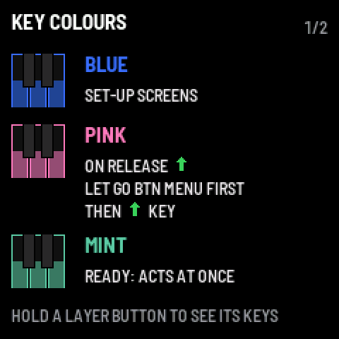 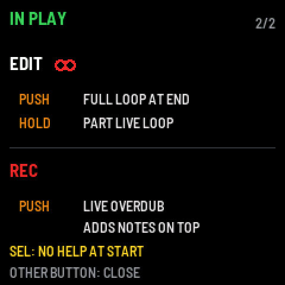

## The layers

Holding a layer button shows its keys. The FM-1 has 27 keys from F: the functions are on the same white and black keys, counted from the left.

### Tracks — SEL held

The mutes act at once; the rest is valid on release (let SEL go first).

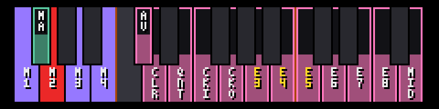

| Key | Function |
|---|---|
| **M1–M4** | Mute / unmute tracks 1 to 4 |
| **CLR** | CLEAR: the selected track wiped |
| **QNT** | QUANTIZE |
| **CKI** | CLOCK IN: follows the external MIDI clock |
| **CKO** | CLOCK OUT: sends the MIDI clock |
| **E3–E5** (yellow) | Euclid 3, 4, 5 hits |
| **E6–E8** | Euclid 6, 7, 8 hits |
| **MID** | FULL MIDI mode (controller) |
| **MA** | Black key 1: MUTE ALL, the four tracks |
| **AV** | Black key 4: A VOL, the levels brought together |

### Perform — SEQ held

Loops valid on release (OCT+ from L16: 1/32); the effects act at once. Held = while held, short tap = latched.

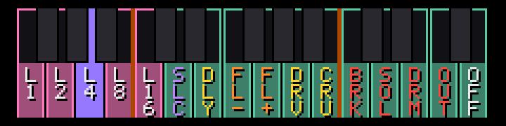

| Key | Function |
|---|---|
| **L1** | Loop 1 bar |
| **L2 L4 L8** | Loops 1/2, 1/4, 1/8 |
| **L16** | Loop 1/16 |
| **SLC** | SLICER: the mix cut in 1/16s |
| **FL-** | Filter shut |
| **FL+** | Filter open |
| **DLY** | Delay throw |
| **DRV** | Drive |
| **CRU** | Crush |
| **BRK** | Break: drums out |
| **SOL** | Solo the track |
| **DRM** | Drums only |
| **OUT** | All out |
| **OFF** | Every effect off |

### Scenes — GLO held

Valid on release. Recalled on the next bar while playing.

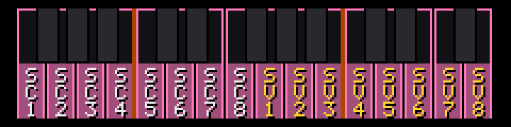

| Key | Function |
|---|---|
| **SC1–SC8** | Recall scene 1 to 8 |
| **SV1–SV8** (yellow) | Store scene 1 to 8 |

### Creative — ARP held

Valid on release (let ARP go first).

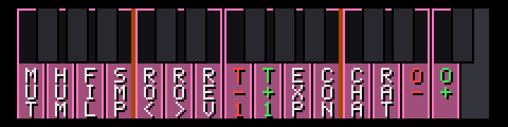

| Key | Function |
|---|---|
| **MUT** | Mutate |
| **HUM** | Humanize |
| **FIL** | Fill |
| **SMP** | Simplify |
| **RO< RO>** | Rotate left / right |
| **REV** | Reverse |
| **T-1** (red) | Transpose −1 |
| **T+1** (green) | Transpose +1 |
| **EXP** | Expand |
| **CON** | Contract |
| **CHA** | Chance |
| **RAT** | Ratchet |
| **O-** (red) | Octave − |
| **O+** (green) | Octave + |

### Home — HOME held

Valid on release. The set-up screens are blue.

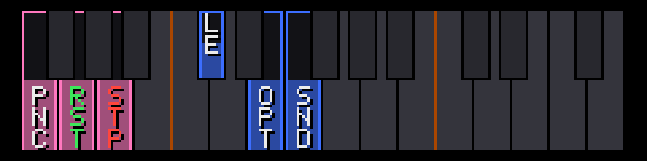

| Key | Function |
|---|---|
| **PNC** | PANIC: every note off |
| **RST** (green) | RESTART: from the top (sync) |
| **STP** (red) | STOP |
| **OPT** | White key 7: OPTION CONTROL |
| **SND** | White key 8: SOUNDS |
| **LE** | Black key 4: LOOP EDIT |

### FX — FX held

Valid on release.

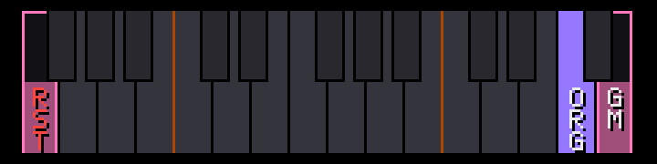

| Key | Function |
|---|---|
| **RST** (red) | The line reset |
| **ORG** | Drum keys ORIGINAL |
| **GM** | Drum keys GM |

### Save — SAVE held

Valid on release. SAVE alone saves nothing; ALL blinks when something is to be saved.

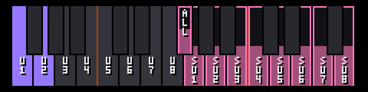

| Key | Function |
|---|---|
| **U1–U8** | Load USER sound 1 to 8 |
| **SU1–SU8** | Store the track’s sound as USER 1 to 8 |
| **ALL** | Black key 6 (between U8 and SU1): SAVE ALL, the whole live set |

### Rec — REC held

Valid on release.

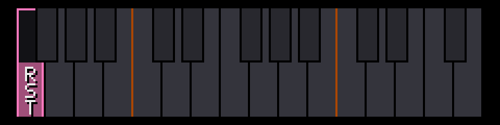

| Key | Function |
|---|---|
| **RST** | White key 1: RESET the track |

## The buttons

| FM-1 | SMK-37 | Alone | Held |
|---|---|---|---|
| **SEL** | **NOTE REPEAT** | takes a sound waiting | Tracks |
| **SEQ** | **SEQ** | lets the loop go | Perform |
| **ARP** | **ARP** | on A: arpeggio mode | Creative |
| **GLO** | **BT** | — | Scenes; GLO + SEL: MAP CONTROL |
| **HOME** | **PATCH** | panic | Home |
| **SAVE** | **PARA** | nothing | Save |
| **FX** | **FX** | next knob page | FX |
| **EDIT** | **GLOBE** | CAPTURE (ENV undoes it) | EDIT + note: punch |
| **ENV / LFO** | **SCALE / CHORD** | UNDO / REDO | — |
| **PLAY / REC** | **PLAY / REC** | transport / record | REC + white key 1: RESET the track |
| **OCT− / OCT+** | **OCT− / OCT+** | octave; family jump; loop ×2 / ÷2 | — |

## The set-up menus

On each, HOME (PATCH on the SMK-37) or the MENU row at the bottom goes back to the play screen.

### OPTION CONTROL

**Open:** HOME + white key 7, HOME let go first

PLAY MODE (LIVE / FULL MIDI), DRUM KEYS, the D# / G# percussions, KEYS ON SCREEN, HELP AT START, the page a new sound brings on T1–T4 and A. SELECT picks the row, PRESET or ALGO changes the value, EDIT puts the default back.

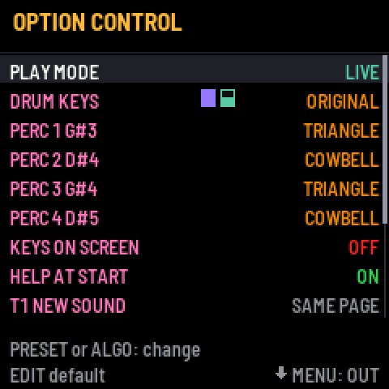 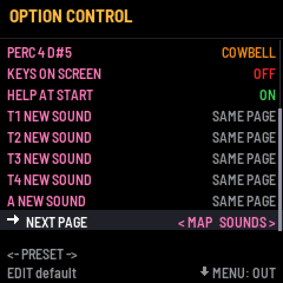

### SOUNDS

**Open:** HOME + white key 8

The sounds PRESET offers, family by family (green: offered). SEL takes a sound out or back, OCT− / OCT+ the whole family. The top line names the chosen sound.

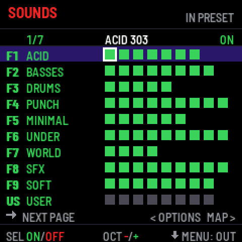 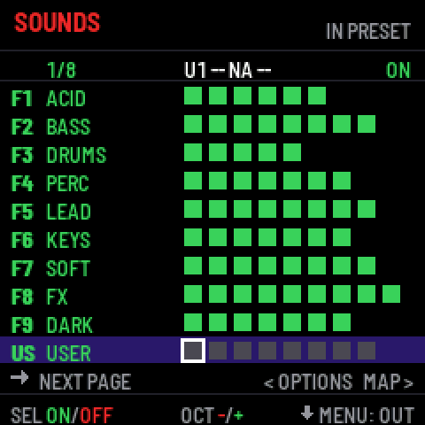

### LOOP EDIT

**Open:** HOME + black key 4

The notes of the track's loop: POS, LEN, VEL, NOTE. REC deletes the note, EDIT adds one; EDIT + keys: a chord.

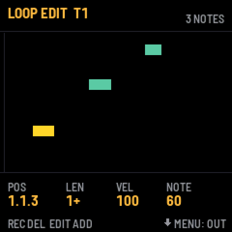

### MAP CONTROL

**Open:** GLO + SEL

The order of the knob pages in FX's turn (and which are in it), then what each knob of the LIVE, EQ and USER pages controls.

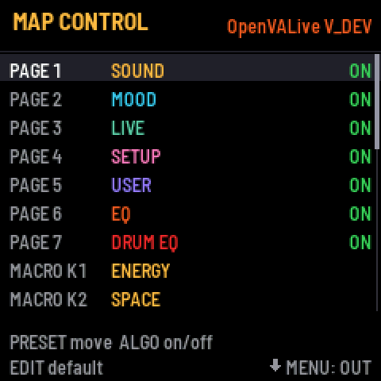 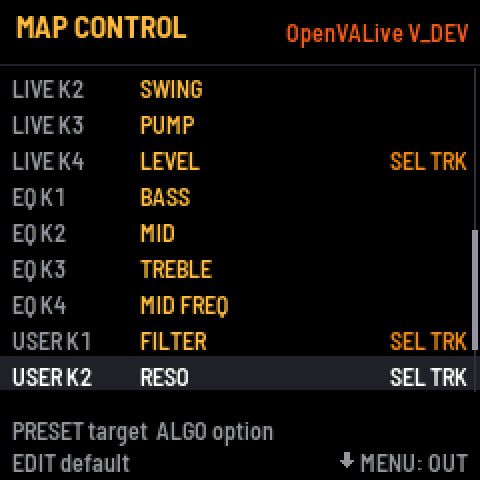

### SOUND EDIT

**Open:** ARP + SEL

Every parameter of the line's sound: oscillators, filter, envelopes, then the modulation matrix. SELECT picks, PRESET changes, ALGO fine.

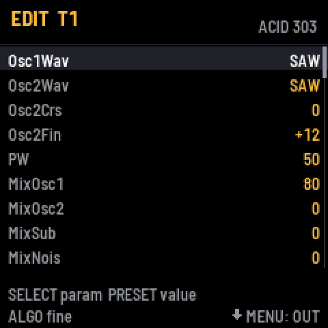 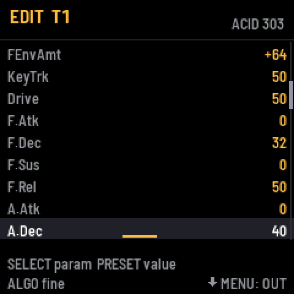 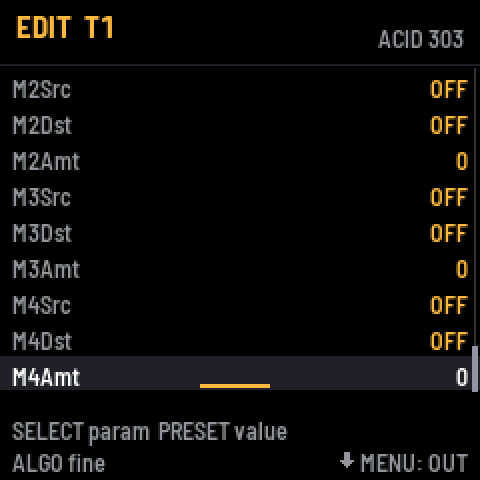

## The sounds

PRESET goes through them in this order, OCT− / OCT+ jump from one family to the next; each sound is described in [doc 20](20-sounds-and-drum-keys.md).

| Family | Sounds |
|---|---|
| **F1 ACID** | 1 ACID 303, 2 SQUELCH, 3 ACID SQUARE, 4 ACID DEEP, 5 ACID SCREAM, 6 TALK |
| **F2 BASS** | 7 BASS, 8 SUB, 9 REESE, 10 PSY BASS, 11 DEEP SUB, 12 BOOM, 13 RUBBER, 14 WOBBLE |
| **F3 DRUMS** | 15 DRUMS 808, 16 DRUMS 909, 17 DRUMS TIGHT, 18 DRUMS LOFI, 19 DRUMS IRON |
| **F4 PERC** | 20 PLUCK, 21 BLEEP, 22 CLICK, 23 METAL, 24 PLATE, 25 BLIP, 26 DROPS |
| **F5 LEAD** | 27 LEAD, 28 GOA LEAD, 29 HOOVER, 30 ARP, 31 RAVE SAX, 32 BRASS, 33 BAGPIPE, 34 INIT |
| **F6 KEYS** | 35 STAB, 36 DEEP STAB, 37 DUB CHORD, 38 POLY, 39 ORGAN, 40 VINTAGE KEYS, 41 LUTE |
| **F7 SOFT** | 42 PAD, 43 STRINGS, 44 DEEP PAD, 45 STRINGS 70, 46 CHOIR, 47 SWEEP, 48 FLUTE, 49 WHALE |
| **F8 FX** | 50 RISER, 51 DOWNLIFTER, 52 NOISE, 53 ZAP, 54 LASER, 55 DUB SIREN, 56 SHAKER, 57 RAIN, 58 THUNDER |
| **F9 DARK** | 59 DRONE, 60 RUMBLE, 61 WIND, 62 HOLD, 63 CREAK, 64 GRUNGE, 65 SCREECH |
| **US USER** | USER 1–8: your sounds, named after their origin ("U3 ACID 303", "U3 -- NA --" when it is unknown) |
