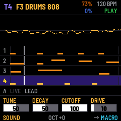

# 05 — Utiliser le FM-1 (V0.2)

Le manuel illustré publié avec le firmware est [`targets/fm1/docs/MANUAL.md`](../../targets/fm1/docs/MANUAL.md)
(en anglais). Cette page est l'aide-mémoire. Le fonctionnement des boucles, de CAPTURE et du Creative Engine :
[16 — Le Live Core](https://github.com/Tom-Rfid/OpenVALive_CORE/blob/dev/docs/_FR/16-le-live-core.md).

 

## Commandes

| Commande | Action |
|---|---|
| **Touches** | jouent la piste sélectionnée, avec la vélocité ; aussi envoyées en USB-MIDI (canal 1) |
| **SELECT** (tourner) | piste 1 à 4 |
| **PRESET** (tourner) | son de la piste : dans cet ordre : ACID 303, BASS, SUB, les 5 kits de batterie (808, 909, TIGHT, LOFI, IRON), LEAD, PLUCK, BRASS, ORGAN, PAD, STRINGS, SWEEP, GRUNGE, SCREECH, DRONE, WIND, HOLD, WHALE, INIT, puis USER 1–8 |
| **ALGO** (tourner) | tempo, 20 à 300 BPM |
| **K1..K4** | la page de boutons (ci-dessous) |
| **FX** | page suivante (SOUND orange / MACRO cyan / LIVE menthe / SETUP rose / USER violet) |
| **SEL** | tenu : couche des pistes (plus bas) ; appuyé : prend un son en attente (**+SEL**) ; tenu + SELECT : pointer une ligne, relâché : la sélectionner — depuis A (SEL allumé) : **échange** A et cette piste (sons, effets, octaves ; ENV sur la piste ré-échange) |
| **SELECT après la piste 4** | **A**, la ligne live : les touches jouent le son propre de A en direct (PRESET), sans l'enregistrer ; ARP tapé = arpège UP / DOWN / UP-DOWN / RANDOM ; les gestes agissent sur toutes les pistes |
| **PLAY** | lecture / arrêt |
| **REC** | enregistre dans la piste (lance la lecture) ; une prise = un pas d'annulation |
| **EDIT** | tapé : **CAPTURE** (la phrase qu'on vient de jouer devient la boucle) ; tenu + touches en lecture : **PUNCH** (enregistre par-dessus en remplaçant, jusqu'au relâchement d'EDIT ; EDIT clignote pendant l'enregistrement) |
| **ENV / LFO** | ANNULER / RÉTABLIR (8 pas) de la piste sélectionnée ; rien sur A (que du live) |
| **SAVE** | enregistre tout le live set (sons, boucles, scènes, tempo...) au relâchement ; allumé s'il y a du changement |
| **SAVE + touche blanche 1–8** | garde le son de la piste en USER 1–8 |
| **SEL + REC / SEL + PLAY** | métronome (REC depuis l'arrêt compte une mesure) / tap tempo |
| **HOME tenu à l'allumage** | démarrage sûr : le set enregistré n'est pas chargé |
| **HOME** + touche blanche 1 / 2 / 3, HOME relâché d'abord | PANIC / RESTART (toutes les pistes à leur début) / STOP ALL |
| **FX** + touche blanche 1, FX relâché d'abord | remise à zéro de la ligne : effets coupés, réactivée, octave 0, niveau d'origine |
| **FX** + touche blanche 15 / 16, FX relâché d'abord | touches de batterie ORIGINAL / GM ([20](20-sons-et-touches-batterie.md)), gardé tout de suite |
| **HOME** + touche blanche 16, HOME relâché d'abord | les réglages : DRUM KEYS, DRUM D#, DRUM G#, KEYS ON SCREEN |
| **PRESET**, puis OCT− / OCT+ dans les 2 s (ou tant qu'un son attend SEL) | famille de sons précédente / suivante, affichée devant le nom : F1 acid, F2 basses, F3 batteries, F4 leads et claviers, F5 nappes, F6 textures, F7 USER |
| **FX** (tap) sur une piste de batterie | les pages font SOUND → MACRO → LIVE → SETUP → USER → **DRUM EQ** (rouge) : K1 graves (BASS), K2 aigus (TREBLE), K3 le niveau de la grosse caisse, K4 celui des charleys (une piste synthé la saute) |
| **HOME** + touche blanche 14, HOME relâché d'abord | **SOUNDS** : les sons que PRESET propose. L'écran reste ouvert HOME relâché (les deux mains libres). Une ligne par famille F1–F7 : toute la ligne rouge = famille masquée, « F2 » en bleu = en partie, en vert = tout proposé ; un carré par son ; sur la ligne choisie, le nom du son choisi (et sous le titre sa position « F4 3/5 », sa famille et ON / HIDDEN). Le nom de chaque famille prend sa couleur. SELECT la ligne, PRESET le son, SEL proposé (vert) / masqué (rouge), OCT− / OCT+ toute la famille masquée / proposée. Dernière ligne **MENU** : PRESET ou OCT passe aux **SETTINGS** (et la ligne MENU des SETTINGS revient ici). N'importe quel bouton de menu (HOME, FX, ARP, SEQ, GLO, SAVE) ferme et enregistre. Un son masqué continue de jouer là où il est ; PRESET et les sauts de famille le sautent |
| **HOME** + touche blanche 15, HOME relâché d'abord | **LOOP EDIT** de la piste choisie : SELECT passe d'une note à l'autre (elle sonne), une touche lui donne sa hauteur, K1 position (1/16), K2 longueur, K3 vélocité, K4 hauteur ; REC efface la note, EDIT en ajoute une un 1/16 plus loin ; PLAY lance la lecture ; HOME ou SEL pour sortir. Toute l'édition = un seul UNDO (ENV) |
| **OCT− / OCT+** | octave de la ligne sélectionnée, −3 à +3 (T1..T4 et A ont chacune la leur ; un son USER ramène son octave) ; une LOOP en cours : ×2 / ÷2 |
| **MASTER** | volume |

### Pages de boutons

| Page | K1 | K2 | K3 | K4 |
|---|---|---|---|---|
| SOUND, synthé | CUTOFF | RESO | ENV | FX (delay) |
| SOUND, batterie | TUNE | DECAY | CUTOFF | DRIVE |
| SOUND, mode contrôleur | CC 74 | CC 71 | CC 75 | CC 94 |
| MACRO (toutes les pistes) | ENERGY | SPACE | TENSION | DENSITY |
| LIVE | MORPH (entre les deux dernières scènes rappelées) | SWING | PUMP (sidechain) | LEVEL (volume de piste, 0–100, 67 = tel quel) |
| SETUP (préparation) | MIDI IN | XFADE (coupe, 1, 2, 4 mesures) | QUANTIZE | BARS (1–8 mesures ; les mesures ajoutées répètent la boucle) |
| USER (le CONTROL MAP) | ce que tu leur as donné | | | |

### Maintenir un bouton de couche + une touche blanche (F3 = touche 1 ... G5 = touche 16)

| Couche | Touches |
|---|---|
| **ARP** créatif | 1 MUTATE · 2 HUMANIZE · 3 FILL · 4 SIMPLIFY · 5/6 ROTATE </> · 7 REVERSE · 8/9 TRANSPOSE −/+ · 10 EXPAND · 11 CONTRACT · 12 CHANCE · 13 RATCHET · 14/15 OCTAVE −/+ — force = vélocité ; sur une piste, relâcher ARP avant la touche applique (menthe), la touche d'abord annule |
| **GLO** scènes (GLO relâché avant la touche = pris, la touche d'abord = annulé) | 1–8 rappelle la scène 1–8 (en lecture : à la mesure suivante, coupe nette ou fondu) · 9–16 mémorise la scène 1–8 · GLO + PLAY chaîne de scènes · ARP + SEL **SOUND EDIT** (tous les paramètres du son de la piste : formes, filtre, enveloppes, LFO calés sur le tempo, matrice de modulation) · GLO + SEL **CONTROL MAP** (ce que font les 4 boutons de la page USER : un effet, un volume, une macro, un CC MIDI…) · GLO + ALGO mesures par scène |
| **SEQ** jeu (sur une piste : SEQ relâché avant la touche = allumé, verrouillé, refait = éteint ; SEQ tapé = la boucle se relâche ; OCT−/OCT+ = boucle ×2 / ÷2. Sur A : tenir = tant qu'on tient, taper = verrouillé) | 1–6 LOOP 1 mesure…1/32 · 7 FILTRE FERMÉ · 8 FILTRE OUVERT · 9 ENVOI DE DELAY · 10 DRIVE · 11 CRUSH · 12 BREAK · 13 SOLO · 14 DRUMS ONLY · 15 ALL OUT · 16 TOUT COUPER — les pistes retirées reviennent sur la mesure suivante ; une LOOP en cours : sa piste passe en rouge, SEQ clignote ; un effet pris : blanc sur vert en bas, 0,5 s |
| **SEL** pistes | 1–4 muet · 5 MUET LES 4 (A continue) · 6 EFFACER (A : toutes les pistes) · 7 QUANTIZE · 8 HORLOGE MIDI EN ENTRÉE · 9 HORLOGE EN SORTIE · 10–15 EUCLIDE 3..8 coups / 16 · 16 MODE CONTRÔLEUR |

## L'écran

```
T4  DRUMS 808            120 BPM
                     6%     PLAY
───────────────────────────────── oscilloscope
1 ▬  ▬   ▬  ▬  │  ▬   ▬          les quatre boucles, la tête de lecture,
2 ▬▬    ▬▬   ▬▬│     ▬▬          la piste sélectionnée en blanc,
3 ▬    ▬▬▬     │   ▬             une piste muette en grisé
4              │
CUTOFF  RESO   ENV    SEQ
55      20     58     25
            OCT +0       SOUND
```

## Le groupe

| Piste | Son | Voix |
|---|---|---|
| 1 | ACID 303 : façon TB-303, glide, accents | 4 (ACID lui-même est mono) |
| 2 | BASS : mono legato + glide, scie + sub, drive | 1 |
| 3 | LEAD : mono, carré PWM + scie, vibrato, delay | 2 |
| 4 | DRUMS 808 : grosse caisse, caisse claire, clap, charleys, toms, rim, cowbell (à chaque octave : do = grosse caisse, ré = caisse claire, fa# = charley, sol# = triangle...) | — |

Chaque piste peut prendre n'importe quel son (PRESET). 11 voix au total gardent quatre pistes chargées dans le
budget CPU ; au-dessus de 90 %, la piste la plus chargée perd une voix.

## MIDI

Entrée (**USB** et **jack TRS**, tous canaux) : joue la piste sélectionnée, enregistrée et capturée comme les
touches ; CC 74/71 cutoff/résonance, 73/72 attaque/release, 5 glide, 1 vibrato, 93/94 chorus/delay, 120/123 tout
coupé ; pitch bend ±2. **Horloge MIDI** en entrée (start, stop, continue, tempo) quand CLOCK IN est actif.

**Mode contrôleur** (SEL + touche blanche 16, « local off ») : les touches et les boutons envoient seulement du
MIDI (canal = numéro de piste, boutons = CC 74 71 75 94) ; les boucles continuent de jouer dans le FM-1. Le FM-1
devient un clavier MIDI.

Sortie (**USB** seulement, pas de prise MIDI OUT sur le FM-1) : les touches sur le canal de la piste sélectionnée, les boucles des pistes
1–4 sur les canaux 1–4, l'horloge MIDI et start/stop quand CLOCK OUT est actif. L'appareil apparaît comme
« OpenVALive FM-1 ».

### Synchroniser avec une boîte à rythmes (Roland T-8...) ou un logiciel

- **La T-8 mène** (sans ordinateur) : MIDI OUT de la T-8 → MIDI IN du FM-1 (jack TRS). Sur le FM-1 : SEL + touche
  blanche 8 (CLOCK IN), et SEL maintenu + PRESET tourné jusqu'à **CLOCK only** (la T-8 envoie aussi ses notes :
  basse sur le canal 2, batterie sur le 10). Appuyer sur START sur la T-8.
- **Le FM-1 mène** : son horloge sort seulement en USB (pas de prise MIDI OUT) : via un ordinateur ou un boîtier
  hôte USB MIDI vers la T-8, réglée en « MIDI Clock Sync » AUTO, USB ou MIDI. Sur le FM-1 : SEL + touche blanche 9
  (CLOCK OUT).
- Câbles : la T-8 utilise le **MIDI TRS type A**. Si un simple câble TRS ne donne rien, passer par des adaptateurs
  DIN. Les prises SYNC de la T-8 (impulsions analogiques) ne peuvent pas être lues par le FM-1.
- Le MIDI entrant est horodaté à son arrivée : le tempo est suivi sans gigue.
- Un program change n rappelle la scène n + 1 ; la pression (aftertouch, ou appuyer plus fort sur une touche)
  ouvre le filtre.

## Audio USB

fm1-base inclut l'audio USB : le FM-1 est aussi une **carte son** pour l'ordinateur. Enregistrez-le directement
dans votre logiciel. Sans rien dans la prise casque, le haut-parleur reçoit une coupure des graves à 130 Hz (il ne
peut pas jouer plus grave, seulement saturer).
