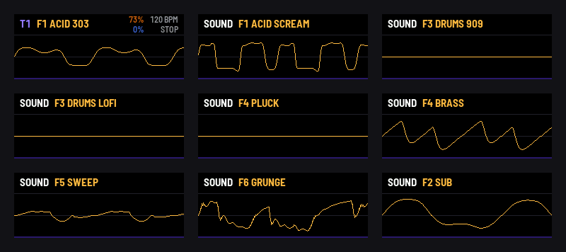
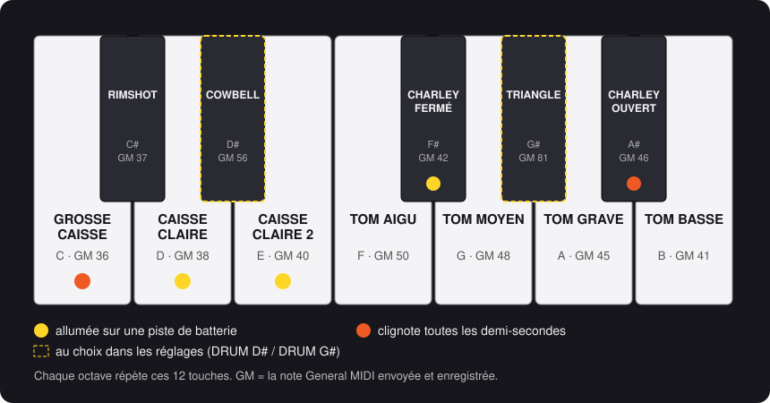

# 20. Les sons et les touches de batterie

PRESET fait défiler les 22 sons d'usine dans cet ordre, puis USER 1–8 (les sons gardés avec SAVE + touche blanche).
La piste 1 démarre sur **ACID 303** (pistes 2, 3, 4 : BASS, LEAD, DRUMS 808). A joue les sons de synthé et les sons
USER qui contiennent un synthé. La même liste sur le FM-1 et le SMK-37. Chaque bouton et touche du FM-1 :
[05](05-utilisation-fm1.md).

L'oscilloscope ci-dessus montre une note grave de chacun (il ajuste son gain : un son doux montre aussi sa forme) :
la scie résonante d'ACID, l'onde ronde de SUB, la scie de BRASS, le chorus de PAD, GRUNGE saturé et écrasé, le filtre
qui siffle de SCREECH, le son pur de WHALE, les deux scies d'INIT, une grosse caisse.

| # | Son | Famille | Ce que c'est |
|---|---|---|---|
| 1 | **ACID 303** | basses | façon TB-303 : une scie, forte résonance, enveloppe courte, glide ; les notes jouées fort ouvrent le filtre (accents), les notes qui se chevauchent glissent. |
| 2 | **ACID SQUARE** | basses | l'autre onde du 303 : un carré, plus creux, le même « squelch » et le glide. |
| 3 | **ACID SCREAM** | basses | l'acid qui crie : résonance au bord, enveloppe de filtre courte et forte, drive poussé. Pour les montées. |
| 4 | **ACID DEEP** | basses | l'acid ronde et hypnotique : filtre bas, déclin long, glide plus long, un peu d'écho (minimale, dub techno). |
| 5 | **BASS** | basses | mono legato avec glide : scie + sous-octave, filtre résonant claquant, saturation. |
| 6 | **SUB** | basses | triangle rond et sa sous-octave, un peu de saturation. |
| 7 | **REESE** | basses | la Reese du drum & bass : deux scies désaccordées l'une contre l'autre, filtre bas, mono. |
| 8 | **WOBBLE** | basses | un LFO au tempo (1/8, repart à chaque note) ouvre et ferme le filtre : le wobble dubstep / DnB. |
| 9 | **DEEP SUB** | basses | la basse profonde du dub : ronde, sub-oscillateur à fond, presque pas de filtre. |
| 10 | **DRUMS 808** | kits de batterie | boîte à rythmes façon analogique : grosse caisse ronde, caisse claire douce, charleys, clap, toms, rim, cowbell, triangle. |
| 11 | **DRUMS 909** | kits de batterie | façon 909 avec les mêmes voix : grosse caisse plus haute et plus courte avec son clic, caisse claire qui claque, charleys métalliques brillants (calculés, pas d'échantillons). |
| 12 | **DRUMS TIGHT** | kits de batterie | court et percutant, pour les motifs rapides. |
| 13 | **DRUMS LOFI** | kits de batterie | sombre et saturé. |
| 14 | **DRUMS IRON** | kits de batterie | industriel : grave, métallique, distordu, longs charleys qui grésillent. |
| 15 | **LEAD** | leads et claviers | mono legato : carré à largeur modulée + scie une octave au-dessus, vibrato, delay. |
| 16 | **PLUCK** | leads et claviers | une attaque brillante qui s'éteint, des échos derrière. |
| 17 | **BRASS** | leads et claviers | le filtre s'ouvre après l'attaque, comme un souffle. |
| 18 | **ORGAN** | leads et claviers | triangle + carré une octave au-dessus + sub, chorus II en guise de cabine tournante. |
| 19 | **PAD** | nappes | attaque lente, filtre qui bouge, chorus façon Juno, delay. |
| 20 | **STRINGS** | nappes | ensemble de cordes : scies désaccordées, attaque lente, les deux chorus. |
| 21 | **SWEEP** | nappes | le pad à travers le phaser. |
| 22 | **GRUNGE** | textures | scies désaccordées et sub, très saturées, phaser et bitcrusher. |
| 23 | **SCREECH** | textures | crissement métallique : un filtre au bord du sifflement, balayé et écrasé. |
| 24 | **DRONE** | textures | un carré une octave plus bas sous une scie, un filtre qui respire sur une demi-minute. Tenir un accord. |
| 25 | **WIND** | textures | bruit filtré : les touches déplacent la bande, un LFO lent respire. |
| 26 | **HOLD** | textures | la cale d'un navire : craquements, la coque qui gémit, longs échos. |
| 27 | **WHALE** | textures | un son pur qui glisse pendant des secondes d'une note à l'autre, balancement lent, échos lointains. Jouer legato, grave. |
| 28 | **DUB SIREN** | textures | la sirène dub : un carré qui monte et descend sur un LFO lent, dans un long écho. Tenir une note. |
| 29 | **INIT** | départ | deux scies légèrement désaccordées : un départ neutre pour SOUND EDIT. |

Sur un son de synthé, les quatre boutons SOUND sont CUTOFF, RESO, ENV, FX (delay) ; SOUND EDIT (ARP + SEL) ouvre
tous les paramètres.

## Les touches de batterie

Sur une piste de batterie, chaque touche joue un instrument, et chaque octave répète les mêmes 12 touches. Deux
cartes, choisies avec **FX + touche blanche 15** (ORIGINAL) ou **FX + touche blanche 16** (GM), en relâchant FX
d'abord ; gardée tout de suite, même après extinction (sans SAVE). Aussi dans les réglages du menu CONTROL MAP :
**HOME + touche blanche 16** (HOME relâché d'abord) l'ouvre dessus (sur le SMK-37 : tenir le bouton Bluetooth).

Quelle que soit la carte, une touche envoie la **note General MIDI** de son instrument (une grosse caisse = 36, un
charley fermé = 42) à la boucle, au MIDI OUT et à l'ordinateur : les Drum Racks d'Ableton et le FPC de FL Studio
jouent les bons instruments sans rien régler.

**ORIGINAL**, faite pour jouer : les toms vont de l'aigu au grave de gauche à droite, comme une batterie vue du
tabouret ; ré# et sol# sont deux sons au choix (DRUM D#, DRUM G# : COWBELL, CLAP, TRIANGLE, RIM, PEDAL HAT ; par
défaut COWBELL et TRIANGLE).

**GM**, la carte des ordinateurs : les notes 36 à 47 du General MIDI, à chaque octave.

Les voyants : les grosses caisses et le charley ouvert clignotent toutes les demi-secondes, les caisses claires et le
charley fermé sont allumés (sur le SMK-37, dont les touches n'ont pas de voyant, l'écran les montre tant qu'un bouton
de couche est tenu).

En MIDI IN, la batterie suit la carte General MIDI, quelle que soit la carte des touches : 35 / 36 grosse caisse,
37 rim, 38 / 40 caisse claire, 39 clap, 41 / 43 tom basse, 45 tom grave, 47 / 48 tom moyen, 50 tom aigu, 42 / 44 / 54
charley fermé, 46 et les cymbales (49, 51, 52, 53, 55, 57, 59) charley ouvert, 56 cowbell, 75 rim (claves), 80 / 81
triangle ; une note que le GM ne nomme pas joue comme sa place dans 36..47. Les six toms GM jouent sur quatre voix,
chacun à sa hauteur. La vélocité règle la force. Sur une piste de batterie, les quatre boutons SOUND sont TUNE,
DECAY, CUTOFF et DRIVE pour tout le kit. Sur le SMK-37, les pads en mode PLAY jouent les notes GM 36 à 51, comme les
boîtes à rythmes. Le script des images : `scripts/make-drum-keys.py`.
