# 22 — Repères : le clavier à l’écran, l’aide et les menus

Tout ce que montre l’écran du FM-1, d’un coup d’œil : les couleurs des touches, les deux pages d’aide du démarrage, chaque couche du clavier avec le nom de ses touches, les boutons, les menus de réglage et les familles de sons. Les écrans viennent du firmware lui-même (simulateur du FM-1 ; le SMK-37 dessine les mêmes, avec NOTE à la place de SEL).

## Les couleurs des touches

| Couleur | Ce que ça veut dire |
|---|---|
| **rose** | validé au relâché : lâcher d’abord le bouton de menu, puis la touche |
| **violet** | actif (une piste qui joue, un effet en cours…) |
| **menthe** | disponible : agit tout de suite |
| **menthe / rose en alternance** | validé au relâché et actif |
| **jaune** | appuyée |
| **bleu** | ouvre un écran de réglage |
| **rouge** | piste coupée (SEL) |

Chaque touche porte son nom (3 caractères au plus, écrits de haut en bas) ; un trait orange foncé marque chaque do.

## L’aide au démarrage

Deux pages qui alternent toutes les 3 s. Les notes les laissent ; SEL (NOTE sur le SMK-37) les coupe pour de bon ; tout autre bouton ou un bouton rotatif les ferme et fait son travail. Un logo coupé avant la fin les saute ; après trois tours (18 s), elles s'en vont seules. Se règle dans OPTION CONTROL : HELP AT START.

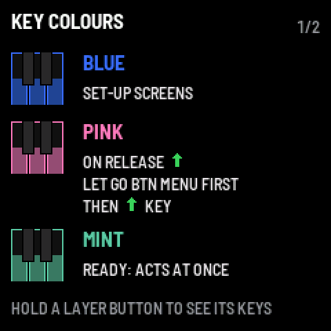 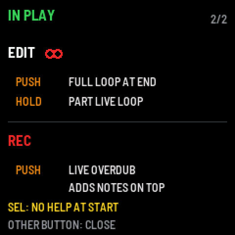

## Les couches

Tenir un bouton de couche montre ses touches. Le FM-1 a 27 touches depuis Fa : les fonctions sont sur les mêmes touches blanches et noires, comptées depuis la gauche.

### Pistes — SEL tenu

Les mutes agissent tout de suite ; le reste est validé au relâché (lâcher SEL en premier).

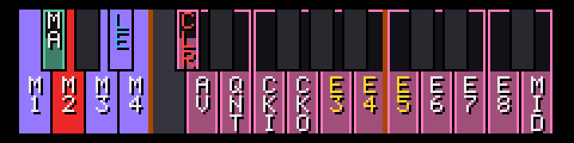

| Touche | Fonction |
|---|---|
| **M1–M4** | Mute / unmute des pistes 1 à 4 |
| **AV** | Blanche 6 : A VOL, les niveaux ramenés ensemble |
| **QNT** | QUANTIZE |
| **CKI** | CLOCK IN : suit l’horloge MIDI externe |
| **CKO** | CLOCK OUT : envoie l’horloge MIDI |
| **E3–E5** (jaune) | Euclide 3, 4, 5 coups |
| **E6–E8** | Euclide 6, 7, 8 coups |
| **MID** | Mode FULL MIDI (contrôleur) |
| **MA** | Noire 1 : MUTE ALL, les quatre pistes |
| **LE** (bleu) | Noire 3 : LOOP EDIT, tout de suite (violet) |
| **CLR** (rouge) | Noire 4 : CLEAR TRACK, efface la piste sélectionnée |

### Perform — SEQ tenu

Par groupes : le temps (boucles, slicer, delay), les filtres, le son (drive, crush), les coupures. Boucles validées au relâché (OCT+ depuis L16 : 1/32) ; les effets agissent tout de suite. Tenir = tant que tenu, tape courte = verrouillé.

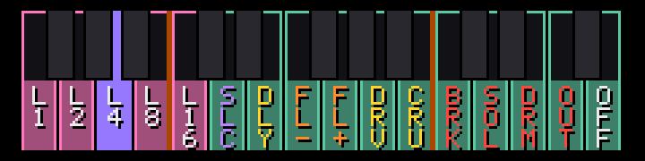

| Touche | Fonction |
|---|---|
| **L1** | Boucle 1 mesure |
| **L2 L4 L8** | Boucles 1/2, 1/4, 1/8 |
| **L16** | Boucle 1/16 |
| **SLC** (violet) | SLICER : la piste choisie coupée en 1/16 (sur A : tout le mix) ; OCT− / OCT+ plus long / plus court |
| **DLY** (jaune) | Delay throw |
| **FL-** (orange) | Filtre fermé |
| **FL+** (orange) | Filtre ouvert |
| **DRV** (jaune) | Drive |
| **CRU** (jaune) | Crush |
| **BRK** (rouge) | Break : batterie coupée |
| **SOL** (rouge) | Solo de la piste |
| **DRM** (rouge) | Drums only |
| **OUT** (rouge) | All out : tout coupé |
| **OFF** | Tous les effets arrêtés |

### Scènes — GLO tenu

Validé au relâché. Rappel à la mesure suivante en lecture.

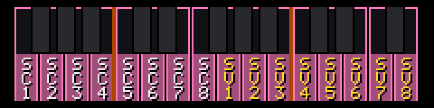

| Touche | Fonction |
|---|---|
| **SC1–SC8** | Rappeler la scène 1 à 8 |
| **SV1–SV8** (jaune) | Mémoriser la scène 1 à 8 |

### Creative — ARP tenu

Validé au relâché (lâcher ARP en premier).

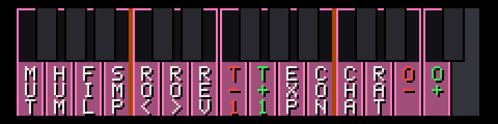

| Touche | Fonction |
|---|---|
| **MUT** | Mutate |
| **HUM** | Humanize |
| **FIL** | Fill |
| **SMP** | Simplify |
| **RO< RO>** | Rotate à gauche / à droite |
| **REV** | Reverse |
| **T-1** (rouge) | Transposer −1 |
| **T+1** (vert) | Transposer +1 |
| **EXP** | Expand |
| **CON** | Contract |
| **CHA** | Chance |
| **RAT** | Ratchet |
| **O-** (rouge) | Octave − |
| **O+** (vert) | Octave + |

### Home — HOME tenu

Validé au relâché. Les écrans de réglage sont en bleu.

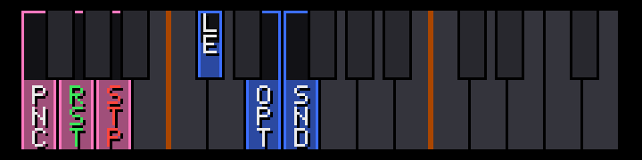

| Touche | Fonction |
|---|---|
| **PNC** | PANIC : toutes les notes coupées |
| **RST** (vert) | RESTART : repart du début (sync) |
| **STP** (rouge) | STOP |
| **OPT** | Blanche 7 : OPTION CONTROL |
| **SND** | Blanche 8 : SOUNDS |
| **LE** | Noire 4 : LOOP EDIT |

### FX — FX tenu

Validé au relâché.

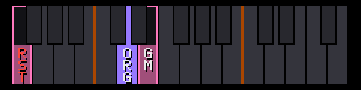

| Touche | Fonction |
|---|---|
| **RST** (rouge) | Remise à zéro de la ligne |
| **ORG** | Blanche 6 : carte batterie ORIGINAL |
| **GM** | Blanche 7 : carte batterie GM |

### Save — SAVE tenu

Validé au relâché. SAVE seul ne sauve rien ; ALL clignote quand il y a quelque chose à sauver.

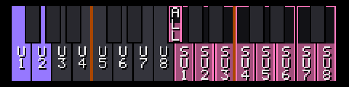

| Touche | Fonction |
|---|---|
| **U1–U8** | Charger le son USER 1 à 8 |
| **SU1–SU8** | Sauver le son de la piste en USER 1 à 8 |
| **ALL** | Noire 6 (entre U8 et SU1) : SAVE ALL, tout le live set |

### Rec — REC tenu

Validé au relâché.

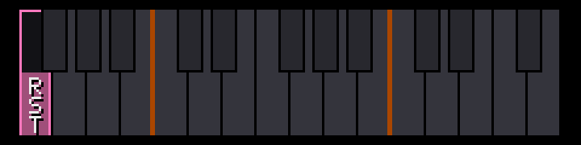

| Touche | Fonction |
|---|---|
| **RST** | Blanche 1 : RESET de la piste |

## Les boutons

| FM-1 | SMK-37 | Seul | Tenu |
|---|---|---|---|
| **SEL** | **NOTE REPEAT** | prend un son en attente | Pistes |
| **SEQ** | **SEQ** | relâche la boucle | Perform |
| **ARP** | **ARP** | sur A : mode d’arpège | Creative |
| **GLO** | **BT** | — | Scènes ; GLO + SEL : MAP CONTROL |
| **HOME** | **PATCH** | panic | Home |
| **SAVE** | **PARA** | rien | Save |
| **FX** | **FX** | page de boutons suivante | FX |
| **EDIT** | **GLOBE** | CAPTURE (ENV l’annule) | EDIT + note : punch |
| **ENV / LFO** | **SCALE / CHORD** | UNDO / REDO | — |
| **PLAY / REC** | **PLAY / REC** | transport / enregistrement | REC + blanche 1 : RESET de la piste |
| **OCT− / OCT+** | **OCT− / OCT+** | octave ; saut de famille ; boucle ×2 / ÷2 | — |

## Les menus de réglage

Sur chacun, HOME (PATCH sur le SMK-37) ou la ligne MENU en bas ramène à l’écran de jeu.

### OPTION CONTROL

**Ouvrir :** HOME + blanche 7, HOME relâché d’abord

PLAY MODE (LIVE / FULL MIDI), DRUM KEYS, les percussions des ré# / sol#, KEYS ON SCREEN, HELP AT START, la page qu’amène un nouveau son sur T1–T4 et A. SELECT choisit la ligne, PRESET ou ALGO change la valeur, EDIT remet la valeur par défaut.

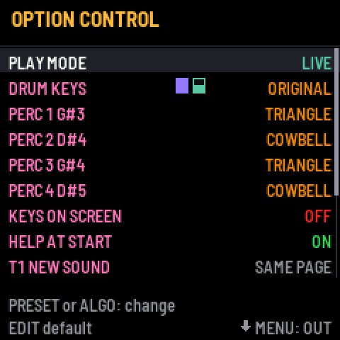 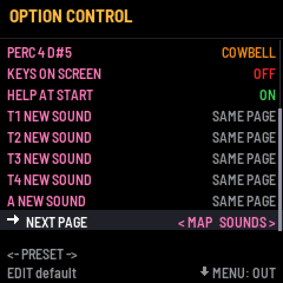

### SOUNDS

**Ouvrir :** HOME + blanche 8

Les sons que PRESET propose, famille par famille (vert : proposé). SEL coupe ou remet un son, OCT− / OCT+ toute la famille. La ligne du haut donne le nom du son choisi.

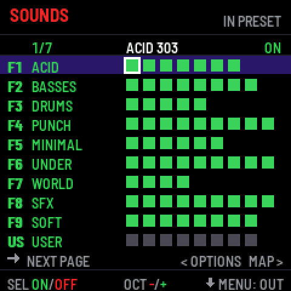 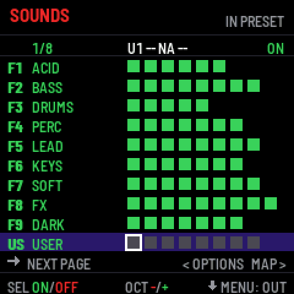

### LOOP EDIT

**Ouvrir :** HOME + noire 4, ou SEL + noire 3 (tout de suite)

Les notes de la boucle de la piste : POS, LEN, VEL, NOTE. REC efface la note, EDIT en ajoute une ; EDIT + touches : un accord.

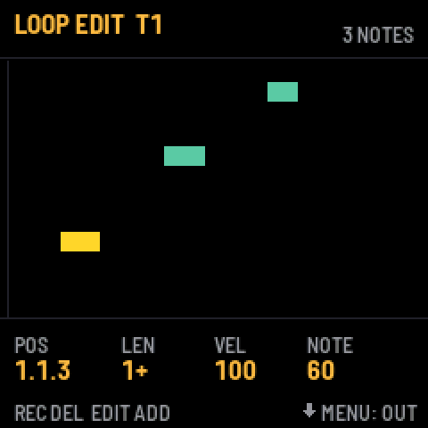

### MAP CONTROL

**Ouvrir :** GLO + SEL

L’ordre des pages de boutons dans le tour de FX (et lesquelles en font partie), puis ce que commande chaque bouton rotatif des pages LIVE, EQ et USER.

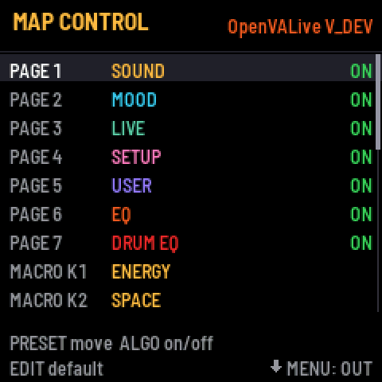 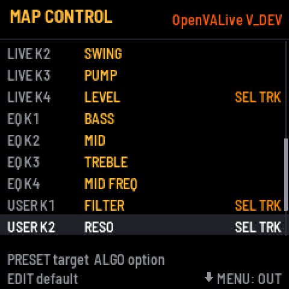

### SOUND EDIT

**Ouvrir :** ARP + SEL

Tous les paramètres du son de la ligne : oscillateurs, filtre, enveloppes, puis la matrice de modulation. SELECT choisit, PRESET change, ALGO règle finement.

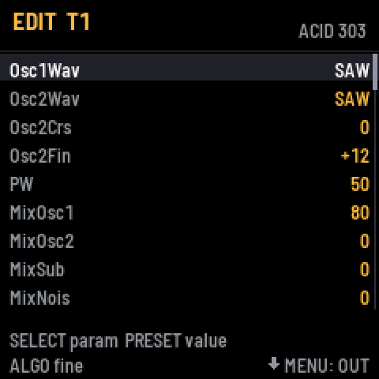 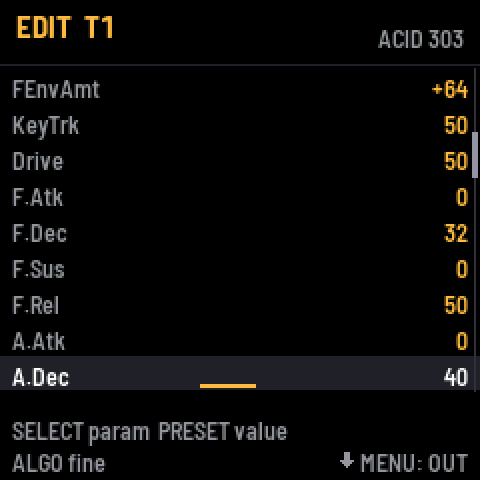 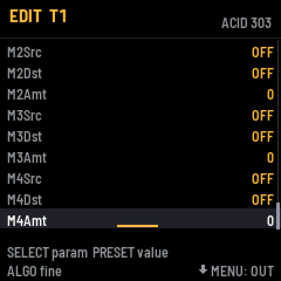

## Les sons

PRESET les fait défiler dans cet ordre, OCT− / OCT+ sautent d’une famille à l’autre ; chaque son est décrit dans [le doc 20](20-sons-et-touches-batterie.md).

| Famille | Sons |
|---|---|
| **F1 ACID** | 1 ACID 303, 2 SQUELCH, 3 ACID SQUARE, 4 ACID DEEP, 5 ACID SCREAM, 6 TALK |
| **F2 BASS** | 7 BASS, 8 SUB, 9 REESE, 10 PSY BASS, 11 DEEP SUB, 12 BOOM, 13 RUBBER, 14 WOBBLE |
| **F3 DRUMS** | 15 DRUMS 808, 16 DRUMS 909, 17 DRUMS TIGHT, 18 DRUMS LOFI, 19 DRUMS IRON |
| **F4 PERC** | 20 PLUCK, 21 BLEEP, 22 CLICK, 23 METAL, 24 PLATE, 25 BLIP, 26 DROPS |
| **F5 LEAD** | 27 LEAD, 28 GOA LEAD, 29 HOOVER, 30 ARP, 31 RAVE SAX, 32 BRASS, 33 BAGPIPE, 34 INIT |
| **F6 KEYS** | 35 STAB, 36 DEEP STAB, 37 DUB CHORD, 38 POLY, 39 ORGAN, 40 VINTAGE KEYS, 41 LUTE |
| **F7 SOFT** | 42 PAD, 43 STRINGS, 44 DEEP PAD, 45 STRINGS 70, 46 CHOIR, 47 SWEEP, 48 FLUTE, 49 WHALE |
| **F8 FX** | 50 RISER, 51 DOWNLIFTER, 52 NOISE, 53 ZAP, 54 LASER, 55 DUB SIREN, 56 SHAKER, 57 RAIN, 58 THUNDER |
| **F9 DARK** | 59 DRONE, 60 RUMBLE, 61 WIND, 62 HOLD, 63 CREAK, 64 GRUNGE, 65 SCREECH |
| **US USER** | USER 1–8 : tes sons, nommés d’après leur origine (« U3 ACID 303 », « U3 -- NA -- » si elle est inconnue) |
