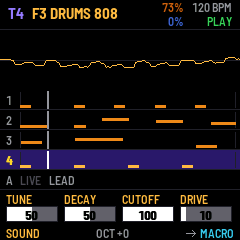

# FM-1 target

The OpenVALive app for the **M-VAVE FM-1**, built on [fm1-base](https://github.com/charlesvestal/fm1-base)
and [felucca-bsp](https://github.com/hugelton/felucca-bsp) (MPL-2.0). The app and the synth are
[OpenVALive CORE](https://github.com/Tom-Rfid/OpenVALive_CORE)'s, in the `va/` submodule: this folder
only says how the FM-1 runs them. How it is wired: [docs/_EN/03](../../docs/_EN/03-the-synth-inside.md).

**Status:** V0.1 (one synth) **tested on a real FM-1** in November 2026: CPU 4 % idle, ~5 % per voice, 26 % worst
case. **V0.2** (the Live Core: four tracks, loops, CAPTURE, undo, scenes, Morph, effects, Creative Engine) passes
every test and the 80 checks in the fm1-base simulator; **it still has to be checked on a real FM-1**.



## Build and install

Easiest: the prebuilt firmware in [`prebuilt/fm1`](../../prebuilt/fm1), the web installer, or
[`INSTALL-WINDOWS.bat`](../../INSTALL-WINDOWS.bat). Step by step: [docs/_EN/04-install.md](../../docs/_EN/04-install.md)
([français](../../docs/_FR/04-installation.md)).

```bash
python3 ~/fm1-base/tools/build.py targets/fm1 --host     # the whole app in the PC simulator
targets/fm1/build/host/openvalive_host targets/fm1/tests/basic.txt targets/fm1/build/host
python3 ~/fm1-base/tools/build.py targets/fm1            # firmware: build/openvalive.fwsc
python3 ~/fm1-base/tools/build.py targets/fm1 --release 0.2.0   # release: build/openvalive-0.2.0.fwsc
```

## Files

| File | Role |
|---|---|
| `app.h` | the FM-1's half of the contract: includes `va/app/openvalive_app.h`, adds the name, splash colour, flash map (`APP_STORE_MAP`), key velocity (`APP_TOUCH`), overload shedding, simulator checks |
| `app.c` | one line: includes `va/app/openvalive_app.c` (fm1-base builds the app as one unit) |
| `ols_dsp.c` | one line: includes `va/app/ols_dsp.c`, the DSP and the Live Core, compiled at `-O2` (`fm1.toml` `o2`) |
| `fm1.toml` | fm1-base build settings (name, identity, site, firmware card) |
| `site/landing.md`, `docs/MANUAL.md`, `docs/img/` | the published site and manual |
| `words.tsv` | words for the screen reader (fm1-reader) |
| `tests/basic.txt` | simulator scenario (80 checks: notes, MIDI, capture, undo, creative, record, scenes, Euclid, mutes, tempo, save and reboot) |
| `tests/screens.txt` | simulator script that makes the screenshots in `docs/img` |

## Watch out

- `id_prefix = "FM-1_023"` with `id_fixed = true`: the package identity, the same for every build, registered on The Firmware Hub.
  **Change it in a fork** ([forking guide](https://github.com/Tom-Rfid/OpenVALive_CORE/blob/dev/docs/_EN/12-forking-guide.md)).
- Flash map: settings at 0xFC000, panel calibration 0xDC000, live set 0xD8000 and 0xDA000, user sounds 0xD6000,
  CONTROL MAP 0xD4000.
- Bluetooth is off (`ble = false`) to keep RAM and flash for music.
- `app_render` runs in the audio interrupt: nothing blocking there, and the UI never touches the engine
  (event queue).

Using it: [docs/_EN/05-using-the-fm1.md](../../docs/_EN/05-using-the-fm1.md) · the manual:
[docs/MANUAL.md](docs/MANUAL.md).
