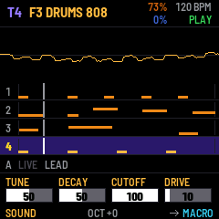
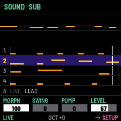
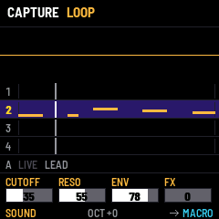
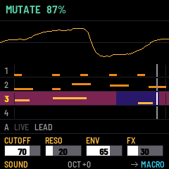
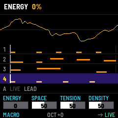
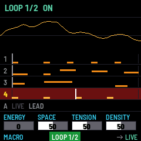
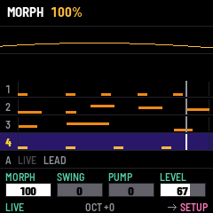
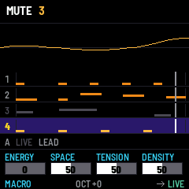
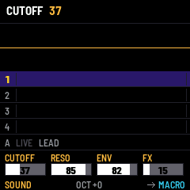
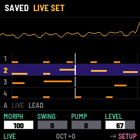

# OpenVALive for the FM-1 — manual

OpenVALive turns the FM-1 into a small live instrument. It has four tracks (synths or an analog-style drum
machine), each playing its own loop.
CAPTURE turns what you just played into a loop, and nearly everything can be undone. Scenes and Morph change the
sound, hold-to-play effects add stutter and filter sweeps, and a Creative Engine reshapes your loops in one
gesture. There are no menus. This manual covers version 0.0.3.

---

## Contents

1. Install
2. The screen
3. Playing, tracks and sounds
4. Loops: PLAY, REC, CAPTURE, UNDO
5. The Creative Engine (hold ARP)
6. Scenes and Morph (hold GLO)
7. Performance effects (hold SEQ)
8. Tracks, quantize, MIDI clock, Euclid (hold SEL)
9. The knobs: SOUND and LIVE pages
10. Saving
11. MIDI and audio
12. Troubleshooting

---

## 1. Install

- **In the browser:** open the [installer](../install/) in Chrome or Edge, connect the FM-1 by USB, follow the page.
- **On Windows, from the source:** double-click `INSTALL-WINDOWS.bat` in the project (it builds and installs).
- **From a command line:** `python3 fm1_install.py openvalive-X.Y.fwsc`.

The installer page also puts M-VAVE's own firmware (V15) back.

## 2. The screen

| Area | What it shows |
|---|---|
| Header | the selected track and its sound; MASTER % (dark orange) over the CPU load (dark blue, red past 80 %); the tempo; STOP, PLAY (green), REC (red) or EXT (MIDI clock) |
| Oscilloscope | the sound itself, about 11 ms of it, held still |
| Tracks 1–4 | each loop: its notes (higher = higher pitch), bar lines, the playhead. The selected track is violet, a muted one dim |
| A | the live line: its sound and arpeggio; mint when selected |
| Knobs | the four values of the page, centred on their bars in grey violet (page colours below) |
| Bottom line | the page (its colour) on the left; the octave (or the perform effect running; just taken: white on green for half a second); on the right an arrow and the page FX turns to next |

A button or a knob shows its name and value in the header for a moment. The boot screen stays 2 seconds; any key,
button or knob cuts it short.

**Changing the sound of a track that plays a loop**: turn PRESET, the sound waits (the track blinks dark orange, the sound is
dark orange, **+SEL** blinking green with the track number); press **SEL** to take it, or select another track to give it up. On an empty track the sound
changes at once.

**Pointing at a line**: hold **SEL** and turn **SELECT**: the line pointed at (1–4 or A) turns violet; let SEL go to
select it.

## 3. Playing, tracks and sounds

| Control | Action |
|---|---|
| Keys | play the selected track, with velocity (also sent over USB-MIDI) |
| SELECT (turn) | choose track 1 to 4 |
| PRESET (turn) | sound of the selected track: 17 synths, 4 drum kits, then your USER sounds (list below) |
| OCT- / OCT+ | octave of the selected line, -3 to +3: T1..T4 and A each keep their own; a USER sound brings back the octave it was kept with. While a LOOP runs: the loop twice as long / half as long (OCT- dark at 1 bar, OCT+ dark at 1/32) |
| HOME + white key 1 / 2 / 3 (HOME let go first) | **PANIC** (every note, effect and loop off; the music goes on) / **RESTART** (every track from its start, now; with a MIDI clock in, the clock keeps them in time) / **STOP ALL** |
| FX + white key 1 (FX let go first) | the selected line plays as it was made: its effects off, unmuted, octave 0, level at unity |
| FX + white key 15 / 16 (FX let go first) | the drum keys: ORIGINAL / GM map (kept at once, no SAVE; [doc 20](../../../docs/_EN/20-sounds-and-drum-keys.md)) |
| HOME + white key 16 (HOME let go first) | the settings rows of the CONTROL MAP menu: DRUM KEYS, DRUM D#, DRUM G#, KEYS ON SCREEN |
| MASTER | volume |

The four tracks start as a band: **1 ACID 303** (mono, glide, accents), **2 BASS** (mono, glide), **3 LEAD** (mono,
vibrato), **4 DRUMS 808**. PRESET shows the sounds in this order: ACID 303, the basses, the five drum kits, the leads
and keys, the pads, the textures, INIT last, then USER 1–8. Each track has its own engines and its own effects. There are 11 synth voices in all, which keeps
the CPU safe when all four tracks play.

| Sound | |
|---|---|
| **ACID 303** | TB-303 style: one saw, high resonance, short envelope, glide; **accents**: hard notes open the filter (the squelch), overlapping notes slide. |
| **BASS** | mono legato with glide: saw + sub-octave, snappy resonant filter, drive. |
| **SUB** | round triangle and its sub-octave, a touch of drive. |
| **DRUMS 808** | analog-style drum machine: boomy kick, soft snare, hats, clap, toms, rim, cowbell. |
| **DRUMS 909** | 909 style from the same voices: a higher, shorter kick with its click, a cracking snare, bright metallic hats (computed, not samples). |
| **DRUMS TIGHT** | short and punchy, for fast patterns. |
| **DRUMS LOFI** | dark and driven. |
| **DRUMS IRON** | industrial: low, metallic, distorted, long rattling hats. |
| **LEAD** | mono legato: pulse-width-modulated square + saw an octave up, vibrato, delay. |
| **PLUCK** | a bright attack that dies away, echoes behind it. |
| **BRASS** | the filter opens after the attack, like a breath. |
| **ORGAN** | triangle + square an octave up + sub, chorus II as a rotary. |
| **PAD** | slow attack, moving filter, Juno-style chorus, delay. |
| **STRINGS** | string ensemble: detuned saws, slow attack, both choruses. |
| **SWEEP** | the pad through the phaser. |
| **GRUNGE** | detuned saws and sub, driven hard, phaser and bitcrusher. |
| **SCREECH** | metal screech: a filter on the edge of whistling, swept and crushed. |
| **DRONE** | an octave-down square under a saw, a filter breathing over half a minute. Hold a chord. |
| **WIND** | filtered noise: the keys move the band, a slow LFO breathes. |
| **HOLD** | a ship's hold: creaks (noise through a ringing filter jerked by a random LFO), the hull groaning, long echoes. |
| **WHALE** | a pure tone sliding for seconds between notes, slow sway, far echoes. Play legato, low. |
| **INIT** | two slightly detuned saws. A neutral start. |

**Your own sounds.** Hold **SAVE** and press white key 1–8: the selected track's sound (every parameter, synth or
drums) is kept as **USER 1–8**. They come after the factory sounds on PRESET, on any track, and are saved with
SAVE. SAVE alone saves the live set when you let go of it.

**Drums on the keys** ([doc 20](../../../docs/_EN/20-sounds-and-drum-keys.md): the keyboard pictures). Every octave
repeats the kit. Two maps (FX + white key 15 / 16): ORIGINAL (C kick, C# rim, D snare, D# your choice (COWBELL), E
snare 2, F high tom, F# closed hat, G mid tom, G# your choice (TRIANGLE), A low tom, A# open hat, B floor tom) or GM
(General MIDI's 36 to 47). Either way a key sends its instrument's General MIDI note, so a computer plays the right
drums; MIDI IN follows General MIDI. On a drum track the kicks and the open hat blink, the snares and the closed hat
are lit; the SOUND knobs are TUNE, DECAY, CUTOFF and DRIVE for the whole kit.

## 4. Loops: PLAY, REC, CAPTURE, UNDO

| Button | Action |
|---|---|
| PLAY | start / stop (lit green while playing) |
| REC | record into the selected track; starts playing if needed. Notes go in as you play them (lit red) |
| EDIT tapped | **CAPTURE**: the phrase you just played becomes the track's loop |
| EDIT held + keys | **PUNCH** (playing): records over the selected track, replacing the notes the playhead passes, until EDIT is let go (one undo step). EDIT flickers while recording |
| ENV | **UNDO** of the selected track (lit when there is something to undo; nothing on A: A is live only) |
| LFO | **REDO** |
| SEL + REC | **METRONOME** on / off. With it on, REC from stop counts one bar in (the notes are taken from bar 2) |
| SEL + PLAY | **TAP TEMPO**: tap a few times, the tempo follows |

**CAPTURE** is the fastest way to make a loop. Every note you play is remembered, recording or not. Play a
phrase, then press EDIT:

- with the transport **stopped**, your first note becomes the downbeat. The loop is 1, 2, 4 or 8 bars, and it
  starts playing right where you are, so it carries on in time with what you were playing;
- with the transport **running**, the phrase keeps its place in the bars.

A silence of a bar and a half ends a phrase. Each track has its own length (FX to the LIVE page, BARS knob), so a
1-bar lead over a 4-bar chord loop shifts against it: that is polymeter.

UNDO goes back up to 8 steps. A whole REC take, a CAPTURE, a creative gesture, a CLEAR or a length change is one
step each.

## 5. The Creative Engine (hold ARP)

Hold **ARP** and press a white key: the screen names the gesture. **Let ARP go first** (the key still held) and it
is applied: the name turns mint for half a second. Let the key go first and nothing happens (when you let the button go, the name turns red for a second), so you can
look before you act. The harder you hit, the stronger the effect. Each gesture works on the selected track's loop
and can be undone. On A, the key acts at once, on every track.

| White key | | What it does |
|---|---|---|
| 1 (F3) | MUTATE | moves some notes to other pitches of the loop, makes accents and ghost notes, shifts a step |
| 2 (G3) | HUMANIZE | small timing and velocity changes, like a player |
| 3 (A3) | FILL | adds notes in the gaps, more towards the end of the loop |
| 4 (B3) | SIMPLIFY | removes the weakest notes first (quiet, off-beat), keeps the downbeat |
| 5 (C4) / 6 (D4) | ROTATE < / > | shifts the loop by one step |
| 7 (E4) | REVERSE | the loop backwards |
| 8 (F4) / 9 (G4) | TRANSPOSE -1 / +1 | one semitone |
| 10 (A4) | EXPAND | twice as long, twice as slow |
| 11 (B4) | CONTRACT | half as long, twice as fast |
| 12 (C5) | CHANCE | off-beat notes get a probability: the loop varies by itself |
| 13 (D5) | RATCHET | some notes become quick repeats (2 to 4 hits) |
| 14 (E5) / 15 (F5) | OCTAVE - / + | the whole loop |

## 6. Scenes and Morph (hold GLO)

A scene is a snapshot of all four sounds and of the mutes.

- Hold **GLO**, press a white key, then **let GLO go first** (the key still held): it is taken (mint). Let the key
  go first and nothing happens (red). The name stays on screen while GLO is held.
- GLO + white keys **9 to 16**: **store** scene 1 to 8.
- GLO + white keys **1 to 8**: **recall** scene 1 to 8. The keys of stored scenes light up. While
  playing, the scene comes **on the next bar** ("NEXT BAR" on the screen): as a cut, or as a **cross-fade** over 1,
  2 or 4 bars (SETUP page, XFADE).
- **Scene chain** (song mode): hold **GLO** and press **PLAY**: the stored scenes play in turn, 4, 8 or 16 bars
  each (hold GLO and turn ALGO), with the cut or cross-fade of the SETUP page. GLO + PLAY again stops it.
- **Morph**: recall a scene, then another. On the LIVE page, K1 (MORPH) glides between the two: 100 % = the last
  one, 0 % = the one before. Levels and filters move smoothly. Waveforms and modes switch half-way.

## 7. Performance effects and transitions (hold SEQ)

Hold **SEQ** and press a white key: the screen names the effect. **Let SEQ go first** (the key still held): the
effect turns on and stays on (the name turns mint); the same gesture again turns it off. Let the key go first and
nothing happens (red). **SEQ tapped** while a LOOP runs lets the selected track's loop go (on A: every loop).
**OCT− / OCT+** while a LOOP runs: twice as long / half as long (OCT− dark at 1 bar, OCT+ dark at 1/32, both lit
otherwise). A LOOP running: its track turns red and SEQ flickers. On A, the keys act at once: hold = while held, tap = latched. Several effects can run together; while SEQ is held, the keys of the running
effects are lit, and the bottom line of the screen names them. Everything else (keys, knobs, PLAY, REC, scenes)
keeps working while effects run.

| White key | Effect |
|---|---|
| 1 to 6 | **LOOP** 1 bar, 1/2, 1/4, 1/8, 1/16, 1/32: every track repeats that slice (one loop at a time); when it stops, the music is where it would have been |
| 7 | FILTER SHUT on every track (drums too) |
| 8 | FILTER OPEN |
| 9 | DELAY THROW (synth tracks) |
| 10 | DRIVE |
| 11 | CRUSH (bitcrusher, synth tracks) |
| 12 | **BREAK**: the drum tracks out |
| 13 | **SOLO**: only the selected track |
| 14 | **DRUMS ONLY**: the synth tracks out |
| 15 | **ALL OUT**: silence |
| 16 | ALL FX OFF |

Tracks taken out by BREAK, SOLO, DRUMS ONLY or ALL OUT go out at once and **come back together on the next bar,
on the one**: hold BREAK through the end of a phrase, let go, and the drums drop on the downbeat.

HOME + white key 1 (PANIC) also stops every effect.

## 8. Tracks, quantize, MIDI clock, Euclid (hold SEL)

**A, the live line.** Turn SELECT past track 4: the line **A** under the tracks turns mint. The keys then play A's
own sound, live over the loops and not recorded (PRESET picks it among the synth sounds; the SOUND page shapes it,
LIVE's LEVEL sets its level). Tap **ARP** for an arpeggio of the keys held: UP, DOWN, UP/DOWN, RANDOM, OFF, on the
16ths of the tempo. With A selected, the perform effects, CLEAR and the Creative Engine act on every track (no UNDO / REDO
on A: it is live only); with a track selected, on that track only. A has its own octave (OCT- / OCT+). A is kept with SAVE.

**Swap A with a track.** On A (SEL lit), hold SEL, point at a synth track with SELECT and let SEL go: A and the
track swap their sounds (every parameter, effects included) and their octaves; the track's loop stays and now plays
A's old sound, A plays the track's. On that track, ENV swaps back (LFO again), as long as nothing newer was done on
it. A drum track does not swap (A plays synth sounds).

**Colours of the knob pages** (knob names, bars, page name bottom right): SOUND orange, MACRO white, LIVE mint
(as A), SETUP pink, USER violet; MACRO cyan. Every bar is white on grey, its value centred in bold black. ENV is lit when there is
something to undo on the selected track, LFO when there is something to redo.

**The lights**: dim = this key or button does something now, lit = it is on. A latched effect blinks.

| Hold SEL + white key | Action |
|---|---|
| 1 to 4 | mute / unmute track 1 to 4 (lit = playing) |
| 5 | MUTE ALL: the four tracks out, or back (A plays on, and A is let go so a key does not sound by mistake) |
| 6 | CLEAR the selected track; with A selected, every track (undoable) |
| 7 | QUANTIZE on / off: recorded notes snap to the 16th |
| 8 | CLOCK IN: follow MIDI clock (start / stop / tempo from the computer or a drum machine) |
| 9 | CLOCK OUT: send MIDI clock and start / stop over USB |
| 10 to 15 | EUCLID: a Euclidean rhythm of 3 to 8 hits over 16 steps, on the last note you played (on a drum track: the kick for C, the snare for D...) |
| 16 | CONTROLLER mode on / off (below) |

**CONTROLLER mode** ("local off") turns the FM-1 into a MIDI keyboard for a computer or another synth. The keys
only send MIDI, on the channel of the selected track (track 1 = channel 1...), and the SOUND page knobs send
CC 74, 71, 75 and 94. The header shows MIDI 1 to MIDI 4. The loops keep playing inside the FM-1, so you can play
an external synth over your own loops. The setting is saved.

## 9. The knobs: SOUND and LIVE pages

**FX** switches the four knobs K1–K4 between five pages:

| Page | K1 | K2 | K3 | K4 |
|---|---|---|---|---|
| SOUND, synth track | CUTOFF | RESO | ENV (middle = none) | FX (delay) |
| SOUND, drum track | TUNE | DECAY | CUTOFF | DRIVE |
| SOUND, controller mode | CC 74 | CC 71 | CC 75 | CC 94 |
| **MACRO** (every track at once, 50 = the sound as it is) | **ENERGY** | **SPACE** | **TENSION** | **DENSITY** |
| LIVE | MORPH (between the last two scenes recalled: store two with GLO + keys 9–16, recall both with GLO + keys 1–8) | SWING | **PUMP** (sidechain) | LEVEL (track volume, 0–100; 67 = as the sound was made) |
| SETUP (prepare your set, not for the middle of it) | MIDI IN (ALL, 1–16, CLOCK) | XFADE (CUT, 1, 2, 4 bars) | QUANTIZE (OFF, 1/16) | BARS (loop length of the track, 1–8; bars added play the loop again) |
| **USER** | what the CONTROL MAP gives K1 | K2 | K3 | K4 |

**The macros** move many parameters of every track with one knob, on top of the sounds (the sounds themselves,
your scenes and your saves do not change; back at 50 you hear them exactly):

| Macro | Up | Down |
|---|---|---|
| ENERGY | brighter, more drive, tighter decays, denser loops | darker, softer, longer, sparser |
| SPACE | more delay and chorus, longer tails | drier, shorter |
| TENSION | resonance, more filter envelope, grit (bitcrusher) above 70 | smoother |
| DENSITY | some notes doubled | off-beat notes thinned out (the beats stay) |

**SOUND EDIT** (hold **ARP** and press **SEL**) shows every parameter of the selected track's sound: SELECT picks
it, PRESET changes it (or picks the next choice), ALGO finely; the keys keep playing; HOME closes. Among them:
**L1Sync / L2Sync** lock an LFO to the tempo (4 bars .. 1/32, dotted, triplets), **L1Trig / L2Trig** restart it at
the first key (RETRIG) or play one cycle (ONE), and the **modulation matrix**: four slots M1..M4, each a source
(LFO1, LFO2, F.ENV, A.ENV, VELO, PRESS, KEY, RANDOM, MOTION), a destination (PITCH, OSC2, PW, CUTOFF, RESO, LEVEL,
MIX, F.ENV, L1RATE, L2RATE, DELAY) and an amount (-100 .. +100).

**The CONTROL MAP** (hold **GLO** and press **SEL**) chooses what the USER page's knobs do. SELECT picks the knob,
PRESET its target (a track LEVEL, a macro, MORPH, SWING, PUMP, an effect: FILTER, RESO, DRIVE, DELAY, CHORUS, CRUSH,
DECAY, a SOUND knob, TEMPO, BEND, aftertouch, a MIDI CC), ALGO its option (which track, ALL tracks, which CC).
HOME closes it and keeps it. An effect knob turned all the way down gives the sounds back as stored. Out of the
box: FILTER, RESO, DELAY, CHORUS on the selected track.

**PUMP** is a sidechain: every hit of the drum track ducks the other tracks, which come back in about 120 ms.
The classic "pumping" of electronic music.

**ALGO** sets the tempo (20–300 BPM).

## 10. Saving, and safe start

**SAVE** keeps the whole live set: the four sounds (every parameter, including those changed over MIDI), the four
loops, the scenes, the tempo, swing, levels and mutes. It is lit while something has changed. The set comes back
at the next power-on.

Updating from 0.1 keeps your 0.1 sound: it becomes track 1's sound.

**Safe start.** Hold **HOME** while switching on, until the screen appears: the saved set is not loaded and the
band starts fresh ("SAFE START"). The saved set stays in flash until your next SAVE. (If the firmware itself
fails to start twice, fm1-base's own SAFE MODE appears: no sound, USB on, reinstall from the web installer.)

## 11. MIDI and audio

- **MIDI in** (USB and the TRS jack, all channels): plays the **selected track**, and is recorded and captured like
  the keys. Pitch bend (±2), CC 74 cutoff, 71 resonance, 73 attack, 72 release, 5 glide, 1 vibrato, 93 chorus, 94
  delay, 120/123 all off. MIDI clock and start / stop when CLOCK IN is on.
- **MIDI out** (USB only: the FM-1 has no MIDI OUT jack): the keys on the selected track's channel (1–4); the loops
  of tracks 1–4 on channels 1–4; MIDI clock when CLOCK OUT is on; the knobs as CCs in controller mode.
- **USB audio:** the FM-1 also appears as a sound card: record it straight into your DAW.
- **MIDI IN channel:** hold SEL and turn PRESET: ALL (default), 1 to 16, or **CLOCK** (only the clock, start and stop
  are followed; notes are ignored, so a drum machine can lead without playing your synth).
- **Program change** n recalls scene n + 1 (if stored): a drum machine changing pattern can change your scene.
- **Aftertouch:** pressing a held key harder (the FM-1 senses it) or MIDI channel pressure opens the filter and
  deepens the vibrato of the selected track. The keys send it out as channel pressure.
- **Speaker:** with nothing in the headphone jack, the sound going to the built-in speaker loses the deep bass it
  cannot play (a low cut at 130 Hz), so it distorts less. Headphones and line out get the whole sound.

### Playing in sync with a drum machine (Roland T-8, TR-8S...) or a DAW

The FM-1 has a MIDI **input** jack but no MIDI **output** jack (its MIDI out is USB only), and no analog sync
jack. So:

| Who leads | How to connect | On the FM-1 | On the other machine |
|---|---|---|---|
| **The T-8** (simplest, no computer) | T-8 **MIDI OUT** → FM-1 **MIDI IN** (TRS jack) | SEL + key 8: CLOCK IN; SEL + PRESET: CLOCK only (or a channel that the T-8 does not use: it sends bass on 2, drums on 10) | press START on the T-8: the FM-1 starts on its first beat |
| **The FM-1** | FM-1 USB → a computer or a USB MIDI host box → T-8 (USB or MIDI IN) | SEL + key 9: CLOCK OUT | T-8 "MIDI Clock Sync" on AUTO, USB or MIDI |
| **A DAW** | both on USB to the computer | CLOCK IN | the same clock |

Watch out for the **TRS MIDI type**: Roland's AIRA Compact (the T-8 included) uses **Type A**. If nothing arrives
with a plain TRS–TRS cable, the other side is Type B: use a Type A → DIN adapter, a DIN cable and the other
device's adapter (or a crossed cable). The T-8's SYNC jacks are analog pulses, which the FM-1 cannot read: use
MIDI. The T-8 does not send song position, so start both from the top of the pattern.

## 12. Troubleshooting

- **No sound:** turn MASTER up; play a key and check that the scope moves. If the header says MIDI 1..4, controller
  mode is on: hold SEL and press the last white key.
- **A track stays silent:** is it muted (dim on the screen)? Hold SEL: the lit keys are the tracks that play.
- **PLAY does nothing:** CLOCK IN is on (header says EXT): the MIDI clock starts and stops the loops.
- **A drum machine plays my synth:** set MIDI IN to CLOCK only (hold SEL, turn PRESET).
- **CPU above 90 %:** voices are dropped automatically. Please report it.
- **The computer doesn't see the FM-1:** use a data USB cable (many only charge), and close other MIDI programs.

More: <https://github.com/Tom-Rfid/OpenVALive_FM-1/blob/main/docs/_EN/10-troubleshooting.md>
